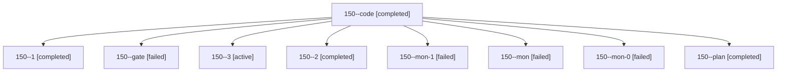

# Session: 150

[Agent Hoods](../README.md) / [bbugyi200](../users/bbugyi200/README.md) / [athena](../users/bbugyi200/machines/athena/README.md) / [150](../users/bbugyi200/machines/athena/hoods/150/README.md) / 150

Owner: `bbugyi200.athena` · Hood: `150` · Members: 9

## Lineage

The diagram is an optional enhancement; the ordered table below contains the same lineage in accessible text.

| Role | Agent | State | Model / provider | Timing | Commits | Prompt | Chat |
|---|---|---|---|---|---:|---|---|
| code | 150--code | completed | gpt-6-luna / codex | 2026-10-28T11:14:01.341396+00:00 → 2026-10-28T11:24:31.946861+00:00 | 0 | [Prompt](../agents/bbugyi200.athena.150--code/prompt.md) | [Chat](../agents/bbugyi200.athena.150--code/chat.md) |
| 1 | 150--1 | completed | gpt-6-luna / codex | 2026-10-28T11:39:21.053122+00:00 → 2026-10-28T11:45:38.189551+00:00 | 0 | [Prompt](../agents/bbugyi200.athena.150--1/prompt.md) | [Chat](../agents/bbugyi200.athena.150--1/chat.md) |
| gate | 150--gate | failed | opus / claude | 2026-10-28T11:10:26.036922+00:00 → 2026-10-28T11:12:03.912964+00:00 | 0 | — | [Chat](../agents/bbugyi200.athena.150--gate/chat.md) |
| 3 | 150--3 | active | grok-4.6 / grok | 2026-10-28T12:36:28.386849+00:00 | 0 | [Prompt](../agents/bbugyi200.athena.150--3/prompt.md) | — |
| 2 | 150--2 | completed | grok-4.6 / grok | 2026-10-28T12:00:57.354563+00:00 → 2026-10-28T12:18:22.542302+00:00 | 0 | [Prompt](../agents/bbugyi200.athena.150--2/prompt.md) | [Chat](../agents/bbugyi200.athena.150--2/chat.md) |
| mon-1 | 150--mon-1 | failed | grok-4.6 / grok | 2026-10-28T12:17:22.971614+00:00 → 2026-10-28T12:34:07.825341+00:00 | 0 | — | [Chat](../agents/bbugyi200.athena.150--mon-1/chat.md) |
| mon | 150--mon | failed | gpt-6-luna / codex | 2026-10-28T11:23:32.536522+00:00 → 2026-10-28T11:40:50.446981+00:00 | 0 | — | [Chat](../agents/bbugyi200.athena.150--mon/chat.md) |
| mon-0 | 150--mon-0 | failed | gpt-6-luna / codex | 2026-10-28T11:43:55.436545+00:00 → 2026-10-28T11:58:44.505925+00:00 | 0 | — | [Chat](../agents/bbugyi200.athena.150--mon-0/chat.md) |
| plan | 150--plan | completed | opus / claude | 2026-10-28T11:00:30.862418+00:00 → 2026-10-28T11:09:34.055598+00:00 | 0 | [Prompt](../agents/bbugyi200.athena.150--plan/prompt.md) | [Chat](../agents/bbugyi200.athena.150--plan/chat.md) |
