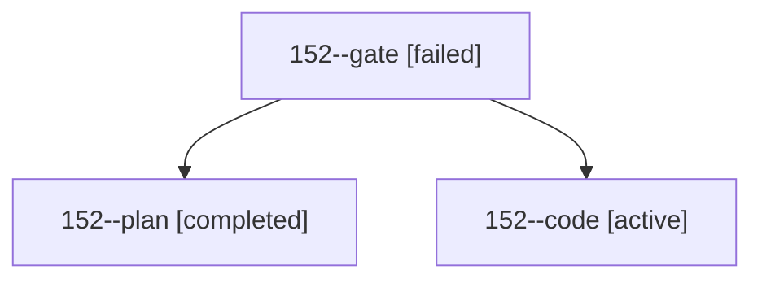

# Session: 152

[Agent Hoods](../README.md) / [bbugyi200](../users/bbugyi200/README.md) / [athena](../users/bbugyi200/machines/athena/README.md) / [152](../users/bbugyi200/machines/athena/hoods/152/README.md) / 152

Owner: `bbugyi200.athena` · Hood: `152` · Members: 3

## Lineage

The diagram is an optional enhancement; the ordered table below contains the same lineage in accessible text.

| Role | Agent | State | Model / provider | Timing | Commits | Prompt | Chat |
|---|---|---|---|---|---:|---|---|
| gate | 152--gate | failed | opus / claude | 2026-10-28T12:40:13.969751+00:00 → 2026-10-28T12:42:13.534207+00:00 | 0 | — | [Chat](../agents/bbugyi200.athena.152--gate/chat.md) |
| plan | 152--plan | completed | opus / claude | 2026-10-28T12:29:37.658518+00:00 → 2026-10-28T12:40:37.545931+00:00 | 0 | [Prompt](../agents/bbugyi200.athena.152--plan/prompt.md) | [Chat](../agents/bbugyi200.athena.152--plan/chat.md) |
| code | 152--code | active | muse-spark-1.3-contributor / muse | 2026-10-28T12:43:56.340832+00:00 | [1](../agents/bbugyi200.athena.152--code/README.md#commits) | [Prompt](../agents/bbugyi200.athena.152--code/prompt.md) | — |

## Commits

| Role | Repo | Commit | Subject | Committed |
|---|---|---|---|---|
| code | bob-cli | [`a314b6a`](https://github.com/bobs-org/bob-cli/commit/a314b6ad5fb7db8c043c046fee01fa686055022c) | feat(task-relations): document tilde-flip-anywhere gesture and LG16 vector | 2026-10-28 09:19:30 EDT |
