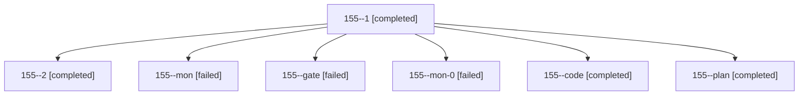

# Session: 155

[Agent Hoods](../README.md) / [bbugyi200](../users/bbugyi200/README.md) / [athena](../users/bbugyi200/machines/athena/README.md) / [155](../users/bbugyi200/machines/athena/hoods/155/README.md) / 155

Owner: `bbugyi200.athena` · Hood: `155` · Members: 7

## Lineage

The diagram is an optional enhancement; the ordered table below contains the same lineage in accessible text.

| Role | Agent | State | Model / provider | Timing | Commits | Prompt | Chat |
|---|---|---|---|---|---:|---|---|
| 1 | 155--1 | completed | grok-4.6 / grok | 2026-10-28T14:08:46.732740+00:00 → 2026-10-28T14:14:56.492289+00:00 | 0 | [Prompt](../agents/bbugyi200.athena.155--1/prompt.md) | [Chat](../agents/bbugyi200.athena.155--1/chat.md) |
| 2 | 155--2 | completed | grok-4.6 / grok | 2026-10-28T14:34:39.773029+00:00 → 2026-10-28T14:41:50.771450+00:00 | [1](../agents/bbugyi200.athena.155--2/README.md#commits) | [Prompt](../agents/bbugyi200.athena.155--2/prompt.md) | [Chat](../agents/bbugyi200.athena.155--2/chat.md) |
| mon | 155--mon | failed | grok-4.6 / grok | 2026-10-28T13:54:06.646883+00:00 → 2026-10-28T14:06:49.388223+00:00 | 0 | — | [Chat](../agents/bbugyi200.athena.155--mon/chat.md) |
| gate | 155--gate | failed | opus / claude | 2026-10-28T13:35:35.615474+00:00 → 2026-10-28T13:37:20.892129+00:00 | 0 | — | [Chat](../agents/bbugyi200.athena.155--gate/chat.md) |
| mon-0 | 155--mon-0 | failed | grok-4.6 / grok | 2026-10-28T14:13:57.107474+00:00 → 2026-10-28T14:31:44.480384+00:00 | 0 | — | [Chat](../agents/bbugyi200.athena.155--mon-0/chat.md) |
| code | 155--code | completed | grok-4.6 / grok | 2026-10-28T13:38:33.384906+00:00 → 2026-10-28T13:54:45.418590+00:00 | 0 | [Prompt](../agents/bbugyi200.athena.155--code/prompt.md) | [Chat](../agents/bbugyi200.athena.155--code/chat.md) |
| plan | 155--plan | completed | opus / claude | 2026-10-28T13:23:07.429144+00:00 → 2026-10-28T13:33:01.608895+00:00 | 0 | [Prompt](../agents/bbugyi200.athena.155--plan/prompt.md) | [Chat](../agents/bbugyi200.athena.155--plan/chat.md) |

## Commits

| Role | Repo | Commit | Subject | Committed |
|---|---|---|---|---|
| 2 | bob-cli | [`f236b9f`](https://github.com/bobs-org/bob-cli/commit/f236b9f6005cd5a61ad12dd9c16862d9e29a96e2) | docs(guides): recover a Mac Capture draft stashed on quit | 2026-10-28 10:38:18 EDT |
