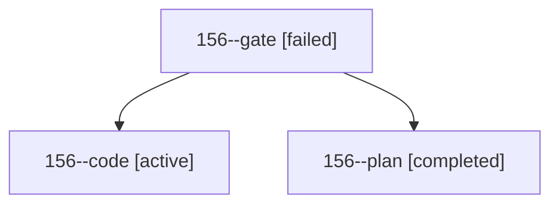

# Session: 156

[Agent Hoods](../README.md) / [bbugyi200](../users/bbugyi200/README.md) / [athena](../users/bbugyi200/machines/athena/README.md) / [156](../users/bbugyi200/machines/athena/hoods/156/README.md) / 156

Owner: `bbugyi200.athena` · Hood: `156` · Members: 3

## Lineage

The diagram is an optional enhancement; the ordered table below contains the same lineage in accessible text.

| Role | Agent | State | Model / provider | Timing | Commits | Prompt | Chat |
|---|---|---|---|---|---:|---|---|
| gate | 156--gate | failed | opus / claude | 2026-10-28T13:38:56.698878+00:00 → 2026-10-28T13:40:46.593190+00:00 | 0 | — | [Chat](../agents/bbugyi200.athena.156--gate/chat.md) |
| code | 156--code | active | muse-spark-1.3-contributor / muse | 2026-10-28T13:42:05.542907+00:00 | [1](../agents/bbugyi200.athena.156--code/README.md#commits) | [Prompt](../agents/bbugyi200.athena.156--code/prompt.md) | — |
| plan | 156--plan | completed | opus / claude | 2026-10-28T13:29:18.960401+00:00 → 2026-10-28T13:38:00.192540+00:00 | 0 | [Prompt](../agents/bbugyi200.athena.156--plan/prompt.md) | [Chat](../agents/bbugyi200.athena.156--plan/chat.md) |

## Commits

| Role | Repo | Commit | Subject | Committed |
|---|---|---|---|---|
| code | bob-cli | [`9e814f0`](https://github.com/bobs-org/bob-cli/commit/9e814f0d1bc54cebd631bf42ab0de63439a664f7) | docs(task-relations): add LG17 Links/Linked-from Blocked ranking vector | 2026-10-28 09:50:00 EDT |
