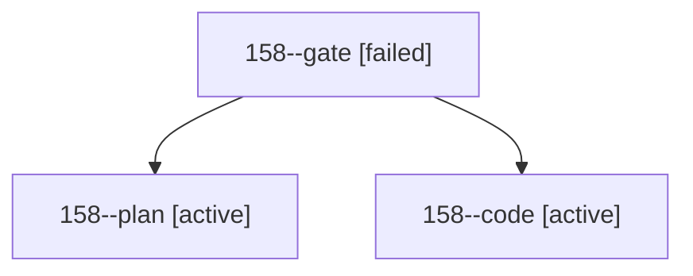

# Session: 158

[Agent Hoods](../README.md) / [bbugyi200](../users/bbugyi200/README.md) / [athena](../users/bbugyi200/machines/athena/README.md) / [158](../users/bbugyi200/machines/athena/hoods/158/README.md) / 158

Owner: `bbugyi200.athena` · Hood: `158` · Members: 3

## Lineage

The diagram is an optional enhancement; the ordered table below contains the same lineage in accessible text.

| Role | Agent | State | Model / provider | Timing | Commits | Prompt | Chat |
|---|---|---|---|---|---:|---|---|
| gate | 158--gate | failed | opus / claude | 2026-10-28T15:29:43.138637+00:00 → 2026-10-28T15:30:59.223727+00:00 | 0 | — | [Chat](../agents/bbugyi200.athena.158--gate/chat.md) |
| plan | 158--plan | active | opus / claude | 2026-10-28T15:13:58.952597+00:00 | 0 | [Prompt](../agents/bbugyi200.athena.158--plan/prompt.md) | [Chat](../agents/bbugyi200.athena.158--plan/chat.md) |
| code | 158--code | active | muse-spark-1.3-contributor / muse | 2026-10-28T15:31:19.466673+00:00 | 0 | — | — |
