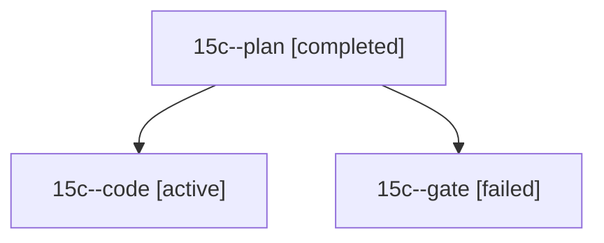

# Session: 15c

[Agent Hoods](../README.md) / [bbugyi200](../users/bbugyi200/README.md) / [athena](../users/bbugyi200/machines/athena/README.md) / [15c](../users/bbugyi200/machines/athena/hoods/15c/README.md) / 15c

Owner: `bbugyi200.athena` · Hood: `15c` · Members: 3

## Lineage



The diagram is an optional enhancement; the ordered table below contains the same lineage in accessible text.

| Role | Agent | State | Model / provider | Timing | Commits | Prompt | Chat |
|---|---|---|---|---|---:|---|---|
| <a id="member-plan"></a>plan | 15c--plan | completed | opus / claude | 2026-10-28T19:42:57.890270+00:00 → 2026-10-28T19:54:32.531784+00:00 | 0 | [Prompt](../agents/bbugyi200.athena.15c--plan/prompt.md) | [Chat](../agents/bbugyi200.athena.15c--plan/chat.md) |
| <a id="member-code"></a>code | 15c--code | active | gpt-6-luna / codex | 2026-10-28T19:58:44.113059+00:00 | 0 | [Prompt](../agents/bbugyi200.athena.15c--code/prompt.md) | — |
| <a id="member-gate"></a>gate | 15c--gate | failed | opus / claude | 2026-10-28T19:55:45.128949+00:00 → 2026-10-28T19:57:06.994089+00:00 | 0 | — | [Chat](../agents/bbugyi200.athena.15c--gate/chat.md) |

## Variables

| Role | Variable | Value |
|---|---|---|
| code | `artifacts` | \[{kind: file, label: Lane-walk membership regression test source, path: /home/bryan/.sase/artifacts/agents/gh\_bobs-org\_\_bob-cli/20261028155706/test-ledger-tools-lane-walk-0e1acbf96fc1.cjs, ref: file:… |

#### artifacts

**Role:** `code`

```yaml
- kind: file
  label: Lane-walk membership regression test source
  path: /home/bryan/.sase/artifacts/agents/gh_bobs-org__bob-cli/20261028155706/test-ledger-tools-lane-walk-0e1acbf96fc1.cjs
  ref: file:explicit:7a43cc030e2d9cce6bc51236
  source_path: /home/bryan/.local/state/sase/workspaces/bobs-org/bob-cli/bob-cli_12/sase/repos/linked/bob-plugins/scripts/test-ledger-tools-lane-walk.cjs
```

Values are truncated for display; see each member's agent meta.json for the full values.
