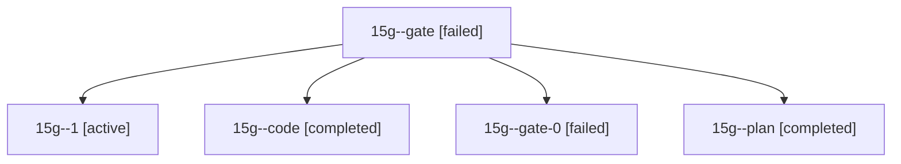

# Session: 15g

[Agent Hoods](../README.md) / [bbugyi200](../users/bbugyi200/README.md) / [athena](../users/bbugyi200/machines/athena/README.md) / [15g](../users/bbugyi200/machines/athena/hoods/15g/README.md) / 15g

Owner: `bbugyi200.athena` · Hood: `15g` · Members: 5

## Lineage

The diagram is an optional enhancement; the ordered table below contains the same lineage in accessible text.

| Role | Agent | State | Model / provider | Timing | Commits | Prompt | Chat |
|---|---|---|---|---|---:|---|---|
| gate | 15g--gate | failed | opus / claude | 2026-10-28T21:35:19.888175+00:00 → 2026-10-28T21:36:26.269895+00:00 | 0 | — | [Chat](../agents/bbugyi200.athena.15g--gate/chat.md) |
| 1 | 15g--1 | active | gpt-6-luna / codex | 2026-10-28T22:03:57.721643+00:00 | 0 | [Prompt](../agents/bbugyi200.athena.15g--1/prompt.md) | — |
| code | 15g--code | completed | gpt-6-luna / codex | 2026-10-28T21:37:45.963965+00:00 → 2026-10-28T21:52:15.980276+00:00 | 0 | [Prompt](../agents/bbugyi200.athena.15g--code/prompt.md) | [Chat](../agents/bbugyi200.athena.15g--code/chat.md) |
| gate-0 | 15g--gate-0 | failed | gpt-6-luna / codex | 2026-10-28T21:58:34.086692+00:00 → 2026-10-28T22:01:05.264607+00:00 | 0 | — | [Chat](../agents/bbugyi200.athena.15g--gate-0/chat.md) |
| plan | 15g--plan | completed | opus / claude | 2026-10-28T21:11:08.378624+00:00 → 2026-10-28T21:20:30.916265+00:00 | 0 | [Prompt](../agents/bbugyi200.athena.15g--plan/prompt.md) | [Chat](../agents/bbugyi200.athena.15g--plan/chat.md) |
