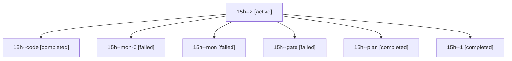

# Session: 15h

[Agent Hoods](../README.md) / [bbugyi200](../users/bbugyi200/README.md) / [athena](../users/bbugyi200/machines/athena/README.md) / [15h](../users/bbugyi200/machines/athena/hoods/15h/README.md) / 15h

Owner: `bbugyi200.athena` · Hood: `15h` · Members: 7

## Lineage

The diagram is an optional enhancement; the ordered table below contains the same lineage in accessible text.

| Role | Agent | State | Model / provider | Timing | Commits | Prompt | Chat |
|---|---|---|---|---|---:|---|---|
| 2 | 15h--2 | active | gpt-6-luna / codex | 2026-10-28T21:58:30.763904+00:00 | 0 | [Prompt](../agents/bbugyi200.athena.15h--2/prompt.md) | — |
| code | 15h--code | completed | gpt-6-luna / codex | 2026-10-28T21:31:17.156932+00:00 → 2026-10-28T21:41:51.140998+00:00 | 0 | [Prompt](../agents/bbugyi200.athena.15h--code/prompt.md) | [Chat](../agents/bbugyi200.athena.15h--code/chat.md) |
| mon-0 | 15h--mon-0 | failed | gpt-6-luna / codex | 2026-10-28T21:52:13.269624+00:00 → 2026-10-28T21:55:20.089047+00:00 | 0 | — | — |
| mon | 15h--mon | failed | gpt-6-luna / codex | 2026-10-28T21:41:14.811717+00:00 → 2026-10-28T21:44:10.009969+00:00 | 0 | — | — |
| gate | 15h--gate | failed | opus / claude | 2026-10-28T21:28:11.989831+00:00 → 2026-10-28T21:29:37.261641+00:00 | 0 | — | [Chat](../agents/bbugyi200.athena.15h--gate/chat.md) |
| plan | 15h--plan | completed | opus / claude | 2026-10-28T21:13:45.658925+00:00 → 2026-10-28T21:24:06.991023+00:00 | 0 | [Prompt](../agents/bbugyi200.athena.15h--plan/prompt.md) | [Chat](../agents/bbugyi200.athena.15h--plan/chat.md) |
| 1 | 15h--1 | completed | gpt-6-luna / codex | 2026-10-28T21:47:01.347296+00:00 → 2026-10-28T21:53:19.838788+00:00 | 0 | [Prompt](../agents/bbugyi200.athena.15h--1/prompt.md) | [Chat](../agents/bbugyi200.athena.15h--1/chat.md) |
