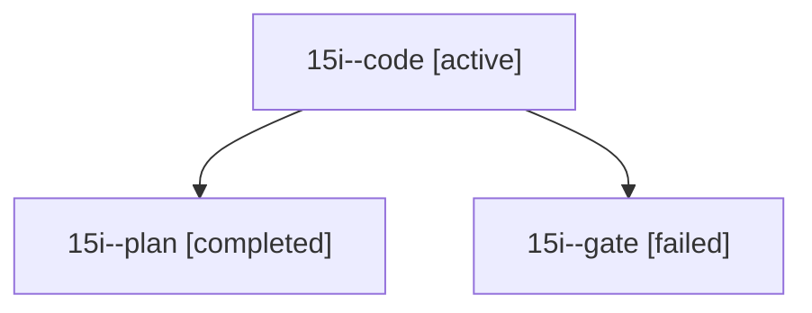

# Session: 15i

[Agent Hoods](../README.md) / [bbugyi200](../users/bbugyi200/README.md) / [athena](../users/bbugyi200/machines/athena/README.md) / [15i](../users/bbugyi200/machines/athena/hoods/15i/README.md) / 15i

Owner: `bbugyi200.athena` · Hood: `15i` · Members: 3

## Lineage

The diagram is an optional enhancement; the ordered table below contains the same lineage in accessible text.

| Role | Agent | State | Model / provider | Timing | Commits | Prompt | Chat |
|---|---|---|---|---|---:|---|---|
| code | 15i--code | active | grok-4.6 / grok | 2026-10-28T22:13:54.296539+00:00 | [1](../agents/bbugyi200.athena.15i--code/README.md#commits) | [Prompt](../agents/bbugyi200.athena.15i--code/prompt.md) | — |
| plan | 15i--plan | completed | opus / claude | 2026-10-28T21:53:26.650750+00:00 → 2026-10-28T22:09:06.174217+00:00 | 0 | [Prompt](../agents/bbugyi200.athena.15i--plan/prompt.md) | [Chat](../agents/bbugyi200.athena.15i--plan/chat.md) |
| gate | 15i--gate | failed | opus / claude | 2026-10-28T22:10:37.362351+00:00 → 2026-10-28T22:12:16.404981+00:00 | 0 | — | [Chat](../agents/bbugyi200.athena.15i--gate/chat.md) |

## Commits

| Role | Repo | Commit | Subject | Committed |
|---|---|---|---|---|
| code | bob-cli | [`74874cb`](https://github.com/bobs-org/bob-cli/commit/74874cb52b0245341fab83360439a7b9929d1bfd) | feat(stats)!: keep every theme in JSON parts summaries | 2026-10-28 19:14:58 EDT |
