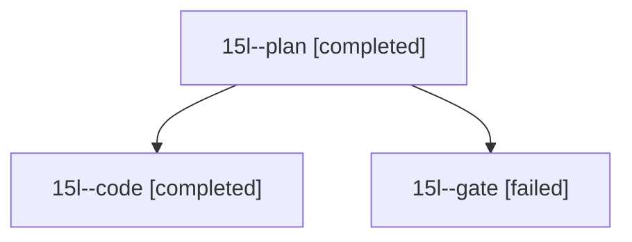

# Session: 15l

[Agent Hoods](../README.md) / [bbugyi200](../users/bbugyi200/README.md) / [athena](../users/bbugyi200/machines/athena/README.md) / [15l](../users/bbugyi200/machines/athena/hoods/15l/README.md) / 15l

Owner: `bbugyi200.athena` · Hood: `15l` · Members: 3

## Lineage

The diagram is an optional enhancement; the ordered table below contains the same lineage in accessible text.

| Role | Agent | State | Model / provider | Timing | Commits | Prompt | Chat |
|---|---|---|---|---|---:|---|---|
| plan | 15l--plan | completed | opus / claude | 2026-10-28T23:25:36.253140+00:00 → 2026-10-29T00:37:40.372990+00:00 | 0 | [Prompt](../agents/bbugyi200.athena.15l--plan/prompt.md) | [Chat](../agents/bbugyi200.athena.15l--plan/chat.md) |
| code | 15l--code | completed | muse-spark-1.3-contributor / muse | 2026-10-29T00:47:28.847471+00:00 → 2026-10-29T01:01:42.405908+00:00 | [1](../agents/bbugyi200.athena.15l--code/README.md#commits) | [Prompt](../agents/bbugyi200.athena.15l--code/prompt.md) | — |
| gate | 15l--gate | failed | opus / claude | 2026-10-29T00:43:42.891621+00:00 → 2026-10-29T00:46:00.787092+00:00 | 0 | — | [Chat](../agents/bbugyi200.athena.15l--gate/chat.md) |

## Commits

| Role | Repo | Commit | Subject | Committed |
|---|---|---|---|---|
| code | — | `38f15d3` | perf(install): speed up just install with incremental local-install profile | 2026-10-28 21:00:06 EDT |
