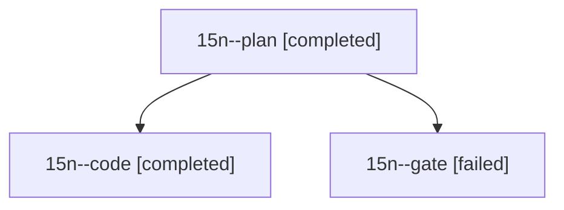

# Session: 15n

[Agent Hoods](../README.md) / [bbugyi200](../users/bbugyi200/README.md) / [athena](../users/bbugyi200/machines/athena/README.md) / [15n](../users/bbugyi200/machines/athena/hoods/15n/README.md) / 15n

Owner: `bbugyi200.athena` · Hood: `15n` · Members: 3

## Lineage

The diagram is an optional enhancement; the ordered table below contains the same lineage in accessible text.

| Role | Agent | State | Model / provider | Timing | Commits | Prompt | Chat |
|---|---|---|---|---|---:|---|---|
| plan | 15n--plan | completed | opus / claude | 2026-10-29T01:20:37.096855+00:00 → 2026-10-29T01:29:28.549360+00:00 | 0 | [Prompt](../agents/bbugyi200.athena.15n--plan/prompt.md) | [Chat](../agents/bbugyi200.athena.15n--plan/chat.md) |
| code | 15n--code | completed | muse-spark-1.3-contributor / muse | 2026-10-29T01:34:38.819704+00:00 → 2026-10-29T02:05:00.094638+00:00 | [1](../agents/bbugyi200.athena.15n--code/README.md#commits) | [Prompt](../agents/bbugyi200.athena.15n--code/prompt.md) | [Chat](../agents/bbugyi200.athena.15n--code/chat.md) |
| gate | 15n--gate | failed | opus / claude | 2026-10-29T01:31:02.017140+00:00 → 2026-10-29T01:32:39.232294+00:00 | 0 | — | [Chat](../agents/bbugyi200.athena.15n--gate/chat.md) |

## Commits

| Role | Repo | Commit | Subject | Committed |
|---|---|---|---|---|
| code | bob-cli | [`65413bd`](https://github.com/bobs-org/bob-cli/commit/65413bd55db8084bb4459e135947a30752f6a17a) | fix(homes): let the ^gtd link, not the PLAN name, decide review time | 2026-10-28 22:02:17 EDT |
