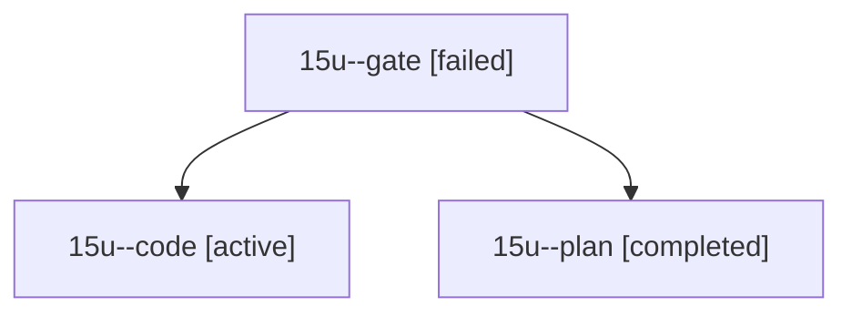

# Session: 15u

[Agent Hoods](../README.md) / [bbugyi200](../users/bbugyi200/README.md) / [athena](../users/bbugyi200/machines/athena/README.md) / [15u](../users/bbugyi200/machines/athena/hoods/15u/README.md) / 15u

Owner: `bbugyi200.athena` · Hood: `15u` · Members: 3

## Lineage

The diagram is an optional enhancement; the ordered table below contains the same lineage in accessible text.

| Role | Agent | State | Model / provider | Timing | Commits | Prompt | Chat |
|---|---|---|---|---|---:|---|---|
| gate | 15u--gate | failed | opus / claude | 2026-10-29T16:30:02.763296+00:00 → 2026-10-29T16:32:32.434350+00:00 | 0 | — | [Chat](../agents/bbugyi200.athena.15u--gate/chat.md) |
| code | 15u--code | active | grok-4.6 / grok | 2026-10-29T16:34:13.351921+00:00 | 0 | [Prompt](../agents/bbugyi200.athena.15u--code/prompt.md) | — |
| plan | 15u--plan | completed | opus / claude | 2026-10-29T16:15:55.577617+00:00 → 2026-10-29T16:25:56.319081+00:00 | 0 | [Prompt](../agents/bbugyi200.athena.15u--plan/prompt.md) | [Chat](../agents/bbugyi200.athena.15u--plan/chat.md) |
