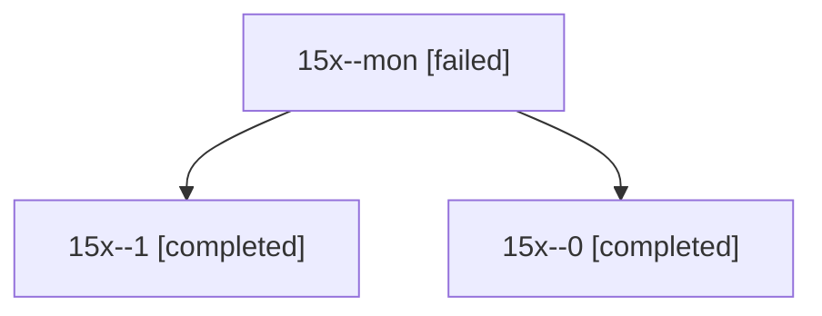

# Session: 15x

[Agent Hoods](../README.md) / [bbugyi200](../users/bbugyi200/README.md) / [athena](../users/bbugyi200/machines/athena/README.md) / [15x](../users/bbugyi200/machines/athena/hoods/15x/README.md) / 15x

Owner: `bbugyi200.athena` · Hood: `15x` · Members: 3

## Lineage

The diagram is an optional enhancement; the ordered table below contains the same lineage in accessible text.

| Role | Agent | State | Model / provider | Timing | Commits | Prompt | Chat |
|---|---|---|---|---|---:|---|---|
| mon | 15x--mon | failed | gpt-6-astra / codex | 2026-10-29T18:07:37.525420+00:00 → 2026-10-29T18:13:35.042853+00:00 | 0 | — | — |
| 1 | 15x--1 | completed | gpt-6-astra / codex | 2026-10-29T18:15:50.648935+00:00 → 2026-10-29T18:21:54.394915+00:00 | 0 | [Prompt](../agents/bbugyi200.athena.15x--1/prompt.md) | [Chat](../agents/bbugyi200.athena.15x--1/chat.md) |
| 0 | 15x--0 | completed | gpt-6-astra / codex | 2026-10-29T18:01:13.099328+00:00 → 2026-10-29T18:10:14.421239+00:00 | 0 | [Prompt](../agents/bbugyi200.athena.15x--0/prompt.md) | [Chat](../agents/bbugyi200.athena.15x--0/chat.md) |
