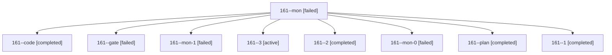

# Session: 161

[Agent Hoods](../README.md) / [bbugyi200](../users/bbugyi200/README.md) / [athena](../users/bbugyi200/machines/athena/README.md) / [161](../users/bbugyi200/machines/athena/hoods/161/README.md) / 161

Owner: `bbugyi200.athena` · Hood: `161` · Members: 9

## Lineage

The diagram is an optional enhancement; the ordered table below contains the same lineage in accessible text.

| Role | Agent | State | Model / provider | Timing | Commits | Prompt | Chat |
|---|---|---|---|---|---:|---|---|
| mon | 161--mon | failed | gpt-6-luna / codex | 2026-10-30T03:11:45.124582+00:00 → 2026-10-30T03:14:12.540032+00:00 | 0 | — | [Chat](../agents/bbugyi200.athena.161--mon/chat.md) |
| code | 161--code | completed | gpt-6-luna / codex | 2026-10-30T03:00:04.079977+00:00 → 2026-10-30T03:11:58.261352+00:00 | 0 | — | [Chat](../agents/bbugyi200.athena.161--code/chat.md) |
| gate | 161--gate | failed | opus / claude | 2026-10-30T02:55:40.977088+00:00 → 2026-10-30T02:58:08.520725+00:00 | 0 | — | [Chat](../agents/bbugyi200.athena.161--gate/chat.md) |
| mon-1 | 161--mon-1 | failed | gpt-6-luna / codex | 2026-10-30T03:41:05.862001+00:00 → 2026-10-30T03:49:19.749239+00:00 | 0 | — | [Chat](../agents/bbugyi200.athena.161--mon-1/chat.md) |
| 3 | 161--3 | active | gpt-6-luna / codex | 2026-10-30T03:54:00.238721+00:00 | [1](../agents/bbugyi200.athena.161--3/README.md#commits) | [Prompt](../agents/bbugyi200.athena.161--3/prompt.md) | — |
| 2 | 161--2 | completed | gpt-6-luna / codex | 2026-10-30T03:33:26.229808+00:00 → 2026-10-30T03:41:25.369571+00:00 | 0 | [Prompt](../agents/bbugyi200.athena.161--2/prompt.md) | [Chat](../agents/bbugyi200.athena.161--2/chat.md) |
| mon-0 | 161--mon-0 | failed | gpt-6-luna / codex | 2026-10-30T03:21:46.635315+00:00 → 2026-10-30T03:30:03.517212+00:00 | 0 | — | [Chat](../agents/bbugyi200.athena.161--mon-0/chat.md) |
| plan | 161--plan | completed | opus / claude | 2026-10-30T02:46:14.109818+00:00 → 2026-10-30T03:11:58.261352+00:00 | 0 | [Prompt](../agents/bbugyi200.athena.161--plan/prompt.md) | [Chat](../agents/bbugyi200.athena.161--plan/chat.md) |
| 1 | 161--1 | completed | gpt-6-luna / codex | 2026-10-30T03:18:30.558569+00:00 → 2026-10-30T03:21:55.558695+00:00 | 0 | [Prompt](../agents/bbugyi200.athena.161--1/prompt.md) | [Chat](../agents/bbugyi200.athena.161--1/chat.md) |

## Commits

| Role | Repo | Commit | Subject | Committed |
|---|---|---|---|---|
| 3 | bob-cli | [`d7888f7`](https://github.com/bobs-org/bob-cli/commit/d7888f7e42eecbc9013ba44dd1ce93d0ff7502b5) | fix(capture): render rewrite help escapes literally | 2026-10-30 00:02:28 EDT |
