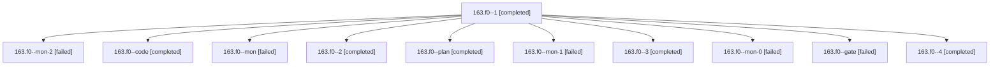

# Session: 163.f0

[Agent Hoods](../README.md) / [bbugyi200](../users/bbugyi200/README.md) / [athena](../users/bbugyi200/machines/athena/README.md) / [163](../users/bbugyi200/machines/athena/hoods/163/README.md) / 163.f0

Owner: `bbugyi200.athena` · Hood: `163` · Members: 11

## Lineage

The diagram is an optional enhancement; the ordered table below contains the same lineage in accessible text.

| Role | Agent | State | Model / provider | Timing | Commits | Prompt | Chat |
|---|---|---|---|---|---:|---|---|
| 1 | 163.f0--1 | completed | muse-spark-1.3-contributor / muse | 2026-10-30T17:37:59.552266+00:00 → 2026-10-30T17:54:16.178382+00:00 | 0 | [Prompt](../agents/bbugyi200.athena.163.f0--1/prompt.md) | [Chat](../agents/bbugyi200.athena.163.f0--1/chat.md) |
| mon-2 | 163.f0--mon-2 | failed | muse-spark-1.3-contributor / muse | 2026-10-30T19:16:44.763053+00:00 → 2026-10-30T19:30:38.951225+00:00 | 0 | — | [Chat](../agents/bbugyi200.athena.163.f0--mon-2/chat.md) |
| code | 163.f0--code | completed | muse-spark-1.3-contributor / muse | 2026-10-30T16:34:51.212202+00:00 → 2026-10-30T17:16:27.155149+00:00 | 0 | [Prompt](../agents/bbugyi200.athena.163.f0--code/prompt.md) | [Chat](../agents/bbugyi200.athena.163.f0--code/chat.md) |
| mon | 163.f0--mon | failed | muse-spark-1.3-contributor / muse | 2026-10-30T17:16:10.411866+00:00 → 2026-10-30T17:26:22.853515+00:00 | 0 | — | [Chat](../agents/bbugyi200.athena.163.f0--mon/chat.md) |
| 2 | 163.f0--2 | completed | muse-spark-1.3-contributor / muse | 2026-10-30T18:11:18.944516+00:00 → 2026-10-30T18:34:17.887932+00:00 | 0 | [Prompt](../agents/bbugyi200.athena.163.f0--2/prompt.md) | [Chat](../agents/bbugyi200.athena.163.f0--2/chat.md) |
| plan | 163.f0--plan | completed | opus / claude | 2026-10-30T16:10:01.360599+00:00 → 2026-10-30T16:18:05.622843+00:00 | 0 | [Prompt](../agents/bbugyi200.athena.163.f0--plan/prompt.md) | [Chat](../agents/bbugyi200.athena.163.f0--plan/chat.md) |
| mon-1 | 163.f0--mon-1 | failed | muse-spark-1.3-contributor / muse | 2026-10-30T18:34:05.088630+00:00 → 2026-10-30T18:47:23.543909+00:00 | 0 | — | [Chat](../agents/bbugyi200.athena.163.f0--mon-1/chat.md) |
| 3 | 163.f0--3 | completed | muse-spark-1.3-contributor / muse | 2026-10-30T18:49:25.577975+00:00 → 2026-10-30T19:16:52.699144+00:00 | 0 | [Prompt](../agents/bbugyi200.athena.163.f0--3/prompt.md) | [Chat](../agents/bbugyi200.athena.163.f0--3/chat.md) |
| mon-0 | 163.f0--mon-0 | failed | muse-spark-1.3-contributor / muse | 2026-10-30T17:53:58.824605+00:00 → 2026-10-30T18:08:50.009341+00:00 | 0 | — | [Chat](../agents/bbugyi200.athena.163.f0--mon-0/chat.md) |
| gate | 163.f0--gate | failed | opus / claude | 2026-10-30T16:26:38.000532+00:00 → 2026-10-30T16:28:30.386799+00:00 | 0 | — | [Chat](../agents/bbugyi200.athena.163.f0--gate/chat.md) |
| 4 | 163.f0--4 | completed | muse-spark-1.3-contributor / muse | 2026-10-30T19:33:04.820806+00:00 → 2026-10-30T19:44:15.511385+00:00 | [1](../agents/bbugyi200.athena.163.f0--4/README.md#commits) | [Prompt](../agents/bbugyi200.athena.163.f0--4/prompt.md) | [Chat](../agents/bbugyi200.athena.163.f0--4/chat.md) |

## Commits

| Role | Repo | Commit | Subject | Committed |
|---|---|---|---|---|
| 4 | bob-cli | [`80808a1`](https://github.com/bobs-org/bob-cli/commit/80808a18afb26f0d2a6b876949d4b82a5f3f4808) | test(capture): wikilink task coexists with trailing template markers | 2026-10-30 15:43:52 EDT |

## Neighbors

| Agent | Relation | State |
|---|---|---|
| [163](bbugyi200.athena.163.md) (session · 15) | ancestor | completed 8, failed 7 |
