# Session: 163

[Agent Hoods](../README.md) / [bbugyi200](../users/bbugyi200/README.md) / [athena](../users/bbugyi200/machines/athena/README.md) / [163](../users/bbugyi200/machines/athena/hoods/163/README.md) / 163

Owner: `bbugyi200.athena` · Hood: `163` · Members: 15

## Lineage

```mermaid
flowchart TD
  n0["163--code [completed]"]
  n1["163--mon [failed]"]
  n0 --> n1
  n2["163--6 [completed]"]
  n0 --> n2
  n3["163--3 [completed]"]
  n0 --> n3
  n4["163--2 [completed]"]
  n0 --> n4
  n5["163--mon-3 [failed]"]
  n0 --> n5
  n6["163--mon-1 [failed]"]
  n0 --> n6
  n7["163--5 [completed]"]
  n0 --> n7
  n8["163--plan [completed]"]
  n0 --> n8
  n9["163--4 [completed]"]
  n0 --> n9
  n10["163--mon-2 [failed]"]
  n0 --> n10
  n11["163--1 [completed]"]
  n0 --> n11
  n12["163--mon-0 [failed]"]
  n0 --> n12
  n13["163--gate [failed]"]
  n0 --> n13
  n14["163--mon-4 [failed]"]
  n0 --> n14
```



The diagram is an optional enhancement; the ordered table below contains the same lineage in accessible text.

| Role | Agent | State | Model / provider | Timing | Commits | Prompt | Chat |
|---|---|---|---|---|---:|---|---|
| <a id="member-code"></a>code | 163--code | completed | gpt-6-luna / codex | 2026-10-30T13:22:40.272643+00:00 → 2026-10-30T13:55:53.691982+00:00 | 0 | [Prompt](../agents/bbugyi200.athena.163--code/prompt.md) | [Chat](../agents/bbugyi200.athena.163--code/chat.md) |
| <a id="member-mon"></a>mon | 163--mon | failed | gpt-6-luna / codex | 2026-10-30T13:55:40.776443+00:00 → 2026-10-30T13:59:17.684022+00:00 | 0 | — | [Chat](../agents/bbugyi200.athena.163--mon/chat.md) |
| <a id="member-6"></a>6 | 163--6 | completed | gpt-6-luna / codex | 2026-10-30T15:36:14.726743+00:00 → 2026-10-30T16:06:31.802096+00:00 | [1](../agents/bbugyi200.athena.163--6/README.md#commits) | [Prompt](../agents/bbugyi200.athena.163--6/prompt.md) | [Chat](../agents/bbugyi200.athena.163--6/chat.md) |
| <a id="member-3"></a>3 | 163--3 | completed | gpt-6-luna / codex | 2026-10-30T14:36:57.830527+00:00 → 2026-10-30T14:44:06.634746+00:00 | 0 | [Prompt](../agents/bbugyi200.athena.163--3/prompt.md) | [Chat](../agents/bbugyi200.athena.163--3/chat.md) |
| <a id="member-2"></a>2 | 163--2 | completed | gpt-6-luna / codex | 2026-10-30T14:15:53.590807+00:00 → 2026-10-30T14:19:56.362688+00:00 | 0 | [Prompt](../agents/bbugyi200.athena.163--2/prompt.md) | [Chat](../agents/bbugyi200.athena.163--2/chat.md) |
| <a id="member-mon-3"></a>mon-3 | 163--mon-3 | failed | gpt-6-luna / codex | 2026-10-30T14:53:43.006331+00:00 → 2026-10-30T15:02:20.551019+00:00 | 0 | — | [Chat](../agents/bbugyi200.athena.163--mon-3/chat.md) |
| <a id="member-mon-1"></a>mon-1 | 163--mon-1 | failed | gpt-6-luna / codex | 2026-10-30T14:19:44.993394+00:00 → 2026-10-30T14:34:25.697851+00:00 | 0 | — | [Chat](../agents/bbugyi200.athena.163--mon-1/chat.md) |
| <a id="member-5"></a>5 | 163--5 | completed | gpt-6-luna / codex | 2026-10-30T15:01:50.190382+00:00 → 2026-10-30T15:14:32.584341+00:00 | 0 | [Prompt](../agents/bbugyi200.athena.163--5/prompt.md) | [Chat](../agents/bbugyi200.athena.163--5/chat.md) |
| <a id="member-plan"></a>plan | 163--plan | completed | opus / claude | 2026-10-30T13:05:12.126581+00:00 → 2026-10-30T13:16:23.545494+00:00 | 0 | [Prompt](../agents/bbugyi200.athena.163--plan/prompt.md) | [Chat](../agents/bbugyi200.athena.163--plan/chat.md) |
| <a id="member-4"></a>4 | 163--4 | completed | gpt-6-luna / codex | 2026-10-30T14:49:48.478263+00:00 → 2026-10-30T14:54:09.156525+00:00 | 0 | [Prompt](../agents/bbugyi200.athena.163--4/prompt.md) | [Chat](../agents/bbugyi200.athena.163--4/chat.md) |
| <a id="member-mon-2"></a>mon-2 | 163--mon-2 | failed | gpt-6-luna / codex | 2026-10-30T14:43:54.631532+00:00 → 2026-10-30T14:45:52.440944+00:00 | 0 | — | [Chat](../agents/bbugyi200.athena.163--mon-2/chat.md) |
| <a id="member-1"></a>1 | 163--1 | completed | gpt-6-luna / codex | 2026-10-30T14:01:34.130656+00:00 → 2026-10-30T14:06:40.495342+00:00 | 0 | [Prompt](../agents/bbugyi200.athena.163--1/prompt.md) | [Chat](../agents/bbugyi200.athena.163--1/chat.md) |
| <a id="member-mon-0"></a>mon-0 | 163--mon-0 | failed | gpt-6-luna / codex | 2026-10-30T14:06:28.297515+00:00 → 2026-10-30T14:13:49.065311+00:00 | 0 | — | [Chat](../agents/bbugyi200.athena.163--mon-0/chat.md) |
| <a id="member-gate"></a>gate | 163--gate | failed | opus / claude | 2026-10-30T13:19:54.408511+00:00 → 2026-10-30T13:21:19.595284+00:00 | 0 | — | [Chat](../agents/bbugyi200.athena.163--gate/chat.md) |
| <a id="member-mon-4"></a>mon-4 | 163--mon-4 | failed | gpt-6-luna / codex | 2026-10-30T15:14:13.319546+00:00 → 2026-10-30T15:34:01.307338+00:00 | 0 | — | [Chat](../agents/bbugyi200.athena.163--mon-4/chat.md) |

## Commits

| Role | Repo | Commit | Subject | Committed |
|---|---|---|---|---|
| 6 | bob-cli | [`4b4a4a3`](https://github.com/bobs-org/bob-cli/commit/4b4a4a340d92b466e651449b22f9bccba4596de9) | feat(capture): expose task-wikilink parse spans | 2026-10-30 11:54:06 EDT |

## Variables

| Role | Variable | Value |
|---|---|---|
| code | `artifacts` | \[{bead: bob-cli-87, kind: file, label: just check table-layout snapshot failure on f40a625a, path: /home/bryan/.sase/artifacts/agents/gh\_bobs-org\_\_bob-cli/20261030092119/bob-cli-check-table-layout-fa… |

#### artifacts

**Role:** `code`

```yaml
- bead: bob-cli-87
  kind: file
  label: just check table-layout snapshot failure on f40a625a
  path: /home/bryan/.sase/artifacts/agents/gh_bobs-org__bob-cli/20261030092119/bob-cli-check-table-layout-failure-ab4ce701fb04.txt
  ref: file:explicit:bb0e1235b43dbbb2b48c58cc
  source_path: /tmp/bob-cli-check-table-layout-failure.txt
```

Values are truncated for display; see each member's agent meta.json for the full values.

## Neighbors

| Agent | Relation | State |
|---|---|---|
| [163.f0](bbugyi200.athena.163.f0.md) (session · 11) | descendant | completed 6, failed 5 |
