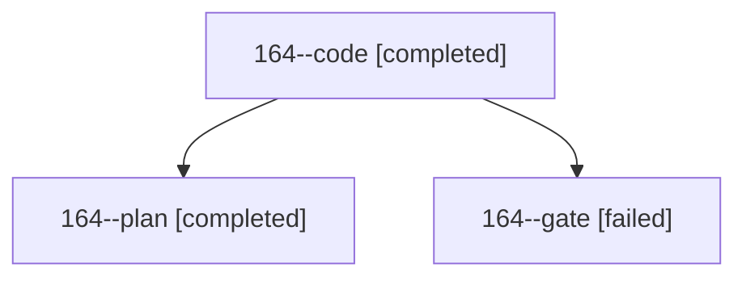

# Session: 164

[Agent Hoods](../README.md) / [bbugyi200](../users/bbugyi200/README.md) / [athena](../users/bbugyi200/machines/athena/README.md) / [164](../users/bbugyi200/machines/athena/hoods/164/README.md) / 164

Owner: `bbugyi200.athena` · Hood: `164` · Members: 3

## Lineage

The diagram is an optional enhancement; the ordered table below contains the same lineage in accessible text.

| Role | Agent | State | Model / provider | Timing | Commits | Prompt | Chat |
|---|---|---|---|---|---:|---|---|
| code | 164--code | completed | grok-4.6 / grok | 2026-10-30T13:48:44.620695+00:00 → 2026-10-30T14:39:52.573012+00:00 | [1](../agents/bbugyi200.athena.164--code/README.md#commits) | [Prompt](../agents/bbugyi200.athena.164--code/prompt.md) | [Chat](../agents/bbugyi200.athena.164--code/chat.md) |
| plan | 164--plan | completed | opus / claude | 2026-10-30T13:21:26.967884+00:00 → 2026-10-30T13:44:23.955054+00:00 | 0 | [Prompt](../agents/bbugyi200.athena.164--plan/prompt.md) | [Chat](../agents/bbugyi200.athena.164--plan/chat.md) |
| gate | 164--gate | failed | opus / claude | 2026-10-30T13:45:15.178485+00:00 → 2026-10-30T13:46:50.807782+00:00 | 0 | — | [Chat](../agents/bbugyi200.athena.164--gate/chat.md) |

## Commits

| Role | Repo | Commit | Subject | Committed |
|---|---|---|---|---|
| code | bob-cli | [`5e4bee7`](https://github.com/bobs-org/bob-cli/commit/5e4bee79486614b9566ebc62309a68247f04dd95) | feat(relations): derive participle-by inverse display phrases | 2026-10-30 10:39:28 EDT |
