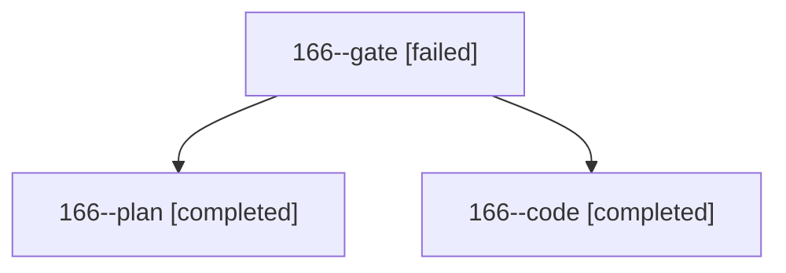

# Session: 166

[Agent Hoods](../README.md) / [bbugyi200](../users/bbugyi200/README.md) / [athena](../users/bbugyi200/machines/athena/README.md) / [166](../users/bbugyi200/machines/athena/hoods/166/README.md) / 166

Owner: `bbugyi200.athena` · Hood: `166` · Members: 3

## Lineage

The diagram is an optional enhancement; the ordered table below contains the same lineage in accessible text.

| Role | Agent | State | Model / provider | Timing | Commits | Prompt | Chat |
|---|---|---|---|---|---:|---|---|
| gate | 166--gate | failed | opus / claude | 2026-10-30T14:09:48.612026+00:00 → 2026-10-30T14:12:01.672471+00:00 | 0 | — | [Chat](../agents/bbugyi200.athena.166--gate/chat.md) |
| plan | 166--plan | completed | opus / claude | 2026-10-30T14:01:18.363534+00:00 → 2026-10-30T14:09:23.870821+00:00 | 0 | [Prompt](../agents/bbugyi200.athena.166--plan/prompt.md) | [Chat](../agents/bbugyi200.athena.166--plan/chat.md) |
| code | 166--code | completed | muse-spark-1.3-contributor / muse | 2026-10-30T14:13:45.029280+00:00 → 2026-10-30T14:46:25.400117+00:00 | [1](../agents/bbugyi200.athena.166--code/README.md#commits) | [Prompt](../agents/bbugyi200.athena.166--code/prompt.md) | [Chat](../agents/bbugyi200.athena.166--code/chat.md) |

## Commits

| Role | Repo | Commit | Subject | Committed |
|---|---|---|---|---|
| code | bob-cli | [`60c7763`](https://github.com/bobs-org/bob-cli/commit/60c77634294d1927cfd6db3766e8054bd6023d7f) | feat(highlights): link annotation tasks to reading task | 2026-10-30 10:45:56 EDT |
