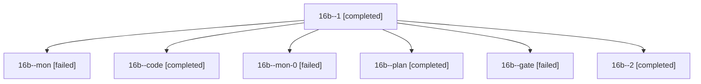

# Session: 16b

[Agent Hoods](../README.md) / [bbugyi200](../users/bbugyi200/README.md) / [athena](../users/bbugyi200/machines/athena/README.md) / [16b](../users/bbugyi200/machines/athena/hoods/16b/README.md) / 16b

Owner: `bbugyi200.athena` · Hood: `16b` · Members: 7

## Lineage

The diagram is an optional enhancement; the ordered table below contains the same lineage in accessible text.

| Role | Agent | State | Model / provider | Timing | Commits | Prompt | Chat |
|---|---|---|---|---|---:|---|---|
| 1 | 16b--1 | completed | grok-4.6 / grok | 2026-10-30T15:19:15.268286+00:00 → 2026-10-30T15:35:27.403420+00:00 | 0 | [Prompt](../agents/bbugyi200.athena.16b--1/prompt.md) | [Chat](../agents/bbugyi200.athena.16b--1/chat.md) |
| mon | 16b--mon | failed | grok-4.6 / grok | 2026-10-30T15:09:04.630400+00:00 → 2026-10-30T15:17:06.586361+00:00 | 0 | — | [Chat](../agents/bbugyi200.athena.16b--mon/chat.md) |
| code | 16b--code | completed | grok-4.6 / grok | 2026-10-30T14:54:43.739966+00:00 → 2026-10-30T15:09:15.512566+00:00 | 0 | [Prompt](../agents/bbugyi200.athena.16b--code/prompt.md) | [Chat](../agents/bbugyi200.athena.16b--code/chat.md) |
| mon-0 | 16b--mon-0 | failed | grok-4.6 / grok | 2026-10-30T15:35:22.063352+00:00 → 2026-10-30T15:44:17.199422+00:00 | 0 | — | [Chat](../agents/bbugyi200.athena.16b--mon-0/chat.md) |
| plan | 16b--plan | completed | opus / claude | 2026-10-30T14:41:10.342963+00:00 → 2026-10-30T14:47:41.337097+00:00 | 0 | [Prompt](../agents/bbugyi200.athena.16b--plan/prompt.md) | [Chat](../agents/bbugyi200.athena.16b--plan/chat.md) |
| gate | 16b--gate | failed | opus / claude | 2026-10-30T14:49:11.757114+00:00 → 2026-10-30T14:52:05.611751+00:00 | 0 | — | [Chat](../agents/bbugyi200.athena.16b--gate/chat.md) |
| 2 | 16b--2 | completed | grok-4.6 / grok | 2026-10-30T15:47:40.033858+00:00 → 2026-10-30T16:00:58.775893+00:00 | [1](../agents/bbugyi200.athena.16b--2/README.md#commits) | [Prompt](../agents/bbugyi200.athena.16b--2/prompt.md) | [Chat](../agents/bbugyi200.athena.16b--2/chat.md) |

## Commits

| Role | Repo | Commit | Subject | Committed |
|---|---|---|---|---|
| 2 | bob-cli | [`a844d3e`](https://github.com/bobs-org/bob-cli/commit/a844d3e19201afbd4c695ef2c57e76552e7fa919) | test(capture): skip vault-sync conflict copies in capture-targets | 2026-10-30 12:00:43 EDT |
