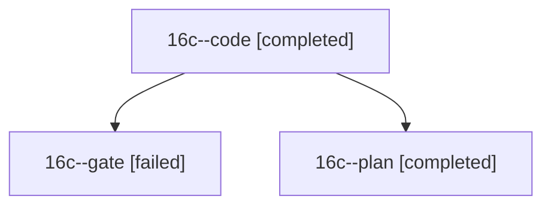

# Session: 16c

[Agent Hoods](../README.md) / [bbugyi200](../users/bbugyi200/README.md) / [athena](../users/bbugyi200/machines/athena/README.md) / [16c](../users/bbugyi200/machines/athena/hoods/16c/README.md) / 16c

Owner: `bbugyi200.athena` · Hood: `16c` · Members: 3

## Lineage

The diagram is an optional enhancement; the ordered table below contains the same lineage in accessible text.

| Role | Agent | State | Model / provider | Timing | Commits | Prompt | Chat |
|---|---|---|---|---|---:|---|---|
| code | 16c--code | completed | muse-spark-1.3-contributor / muse | 2026-10-30T16:15:12.653955+00:00 → 2026-10-30T16:35:55.510921+00:00 | [1](../agents/bbugyi200.athena.16c--code/README.md#commits) | [Prompt](../agents/bbugyi200.athena.16c--code/prompt.md) | [Chat](../agents/bbugyi200.athena.16c--code/chat.md) |
| gate | 16c--gate | failed | opus / claude | 2026-10-30T16:08:00.410182+00:00 → 2026-10-30T16:12:49.007294+00:00 | 0 | — | [Chat](../agents/bbugyi200.athena.16c--gate/chat.md) |
| plan | 16c--plan | completed | opus / claude | 2026-10-30T15:12:10.949607+00:00 → 2026-10-30T16:07:26.401652+00:00 | 0 | [Prompt](../agents/bbugyi200.athena.16c--plan/prompt.md) | [Chat](../agents/bbugyi200.athena.16c--plan/chat.md) |

## Commits

| Role | Repo | Commit | Subject | Committed |
|---|---|---|---|---|
| code | bob-cli | [`7328fab`](https://github.com/bobs-org/bob-cli/commit/7328fab2e984c2b6c599dc6ee8fa646424b23e8d) | fix(ci): restore release-tool and macOS lint/test jobs | 2026-10-30 12:35:44 EDT |
