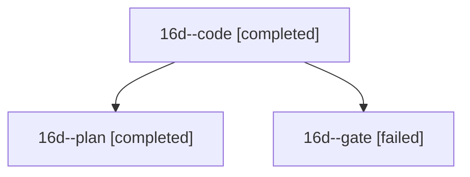

# Session: 16d

[Agent Hoods](../README.md) / [bbugyi200](../users/bbugyi200/README.md) / [athena](../users/bbugyi200/machines/athena/README.md) / [16d](../users/bbugyi200/machines/athena/hoods/16d/README.md) / 16d

Owner: `bbugyi200.athena` · Hood: `16d` · Members: 3

## Lineage

The diagram is an optional enhancement; the ordered table below contains the same lineage in accessible text.

| Role | Agent | State | Model / provider | Timing | Commits | Prompt | Chat |
|---|---|---|---|---|---:|---|---|
| code | 16d--code | completed | grok-4.6 / grok | 2026-10-30T15:36:50.611635+00:00 → 2026-10-30T16:55:22.695217+00:00 | 0 | [Prompt](../agents/bbugyi200.athena.16d--code/prompt.md) | [Chat](../agents/bbugyi200.athena.16d--code/chat.md) |
| plan | 16d--plan | completed | opus / claude | 2026-10-30T15:17:36.690872+00:00 → 2026-10-30T15:32:02.304382+00:00 | 0 | [Prompt](../agents/bbugyi200.athena.16d--plan/prompt.md) | [Chat](../agents/bbugyi200.athena.16d--plan/chat.md) |
| gate | 16d--gate | failed | opus / claude | 2026-10-30T15:32:50.892111+00:00 → 2026-10-30T15:34:43.695867+00:00 | 0 | — | [Chat](../agents/bbugyi200.athena.16d--gate/chat.md) |
