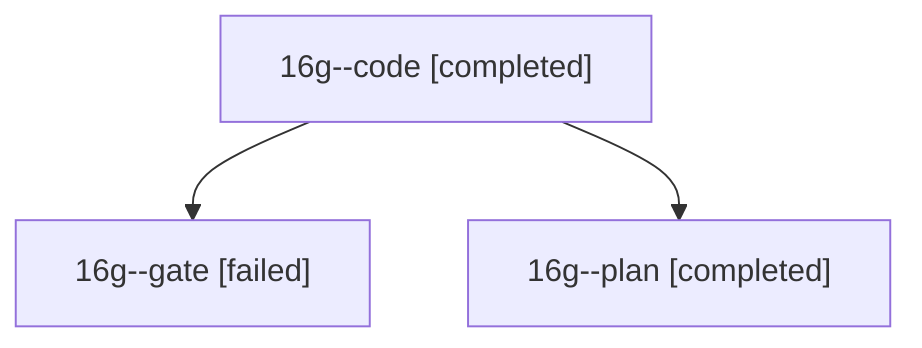

# Session: 16g

[Agent Hoods](../README.md) / [bbugyi200](../users/bbugyi200/README.md) / [athena](../users/bbugyi200/machines/athena/README.md) / [16g](../users/bbugyi200/machines/athena/hoods/16g/README.md) / 16g

Owner: `bbugyi200.athena` · Hood: `16g` · Members: 3

## Lineage

The diagram is an optional enhancement; the ordered table below contains the same lineage in accessible text.

| Role | Agent | State | Model / provider | Timing | Commits | Prompt | Chat |
|---|---|---|---|---|---:|---|---|
| code | 16g--code | completed | grok-4.6 / grok | 2026-10-30T19:28:36.233906+00:00 → 2026-10-30T19:37:09.877739+00:00 | [1](../agents/bbugyi200.athena.16g--code/README.md#commits) | [Prompt](../agents/bbugyi200.athena.16g--code/prompt.md) | [Chat](../agents/bbugyi200.athena.16g--code/chat.md) |
| gate | 16g--gate | failed | opus / claude | 2026-10-30T19:24:40.615680+00:00 → 2026-10-30T19:26:52.125241+00:00 | 0 | — | [Chat](../agents/bbugyi200.athena.16g--gate/chat.md) |
| plan | 16g--plan | completed | opus / claude | 2026-10-30T19:13:20.820749+00:00 → 2026-10-30T19:18:32.089098+00:00 | 0 | [Prompt](../agents/bbugyi200.athena.16g--plan/prompt.md) | [Chat](../agents/bbugyi200.athena.16g--plan/chat.md) |

## Commits

| Role | Repo | Commit | Subject | Committed |
|---|---|---|---|---|
| code | bob-cli | [`43d5f7e`](https://github.com/bobs-org/bob-cli/commit/43d5f7ee100bdb2ee7d10cb82ef8c72b1c6a9099) | docs(glossary): add Command Mode term | 2026-10-30 15:36:57 EDT |
