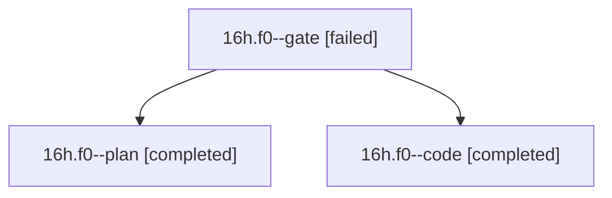

# Session: 16h.f0

[Agent Hoods](../README.md) / [bbugyi200](../users/bbugyi200/README.md) / [athena](../users/bbugyi200/machines/athena/README.md) / [16h](../users/bbugyi200/machines/athena/hoods/16h/README.md) / 16h.f0

Owner: `bbugyi200.athena` · Hood: `16h` · Members: 3

## Lineage

The diagram is an optional enhancement; the ordered table below contains the same lineage in accessible text.

| Role | Agent | State | Model / provider | Timing | Commits | Prompt | Chat |
|---|---|---|---|---|---:|---|---|
| gate | 16h.f0--gate | failed | opus / claude | 2026-10-30T19:36:31.480274+00:00 → 2026-10-30T19:38:19.735729+00:00 | 0 | — | [Chat](../agents/bbugyi200.athena.16h.f0--gate/chat.md) |
| plan | 16h.f0--plan | completed | opus / claude | 2026-10-30T19:27:18.163927+00:00 → 2026-10-30T19:34:48.114096+00:00 | 0 | [Prompt](../agents/bbugyi200.athena.16h.f0--plan/prompt.md) | [Chat](../agents/bbugyi200.athena.16h.f0--plan/chat.md) |
| code | 16h.f0--code | completed | muse-spark-1.3-contributor / muse | 2026-10-30T19:53:21.163245+00:00 → 2026-10-30T20:05:51.351891+00:00 | 0 | [Prompt](../agents/bbugyi200.athena.16h.f0--code/prompt.md) | [Chat](../agents/bbugyi200.athena.16h.f0--code/chat.md) |

## Neighbors

| Agent | Relation | State |
|---|---|---|
| [16h](bbugyi200.athena.16h.md) (session · 3) | ancestor | completed 2, failed 1 |
