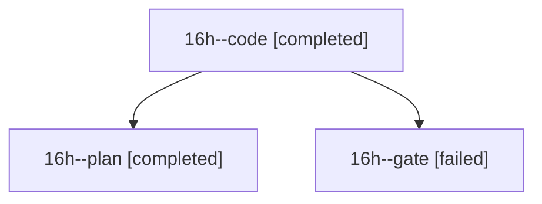

# Session: 16h

[Agent Hoods](../README.md) / [bbugyi200](../users/bbugyi200/README.md) / [athena](../users/bbugyi200/machines/athena/README.md) / [16h](../users/bbugyi200/machines/athena/hoods/16h/README.md) / 16h

Owner: `bbugyi200.athena` · Hood: `16h` · Members: 3

## Lineage

The diagram is an optional enhancement; the ordered table below contains the same lineage in accessible text.

| Role | Agent | State | Model / provider | Timing | Commits | Prompt | Chat |
|---|---|---|---|---|---:|---|---|
| code | 16h--code | completed | grok-4.6 / grok | 2026-10-30T19:32:29.327245+00:00 → 2026-10-30T19:51:36.767679+00:00 | 0 | [Prompt](../agents/bbugyi200.athena.16h--code/prompt.md) | [Chat](../agents/bbugyi200.athena.16h--code/chat.md) |
| plan | 16h--plan | completed | opus / claude | 2026-10-30T19:17:42.609533+00:00 → 2026-10-30T19:25:08.573959+00:00 | 0 | [Prompt](../agents/bbugyi200.athena.16h--plan/prompt.md) | [Chat](../agents/bbugyi200.athena.16h--plan/chat.md) |
| gate | 16h--gate | failed | opus / claude | 2026-10-30T19:28:07.754622+00:00 → 2026-10-30T19:30:48.920281+00:00 | 0 | — | [Chat](../agents/bbugyi200.athena.16h--gate/chat.md) |

## Neighbors

| Agent | Relation | State |
|---|---|---|
| [16h.f0](bbugyi200.athena.16h.f0.md) (session · 3) | descendant | completed 2, failed 1 |
