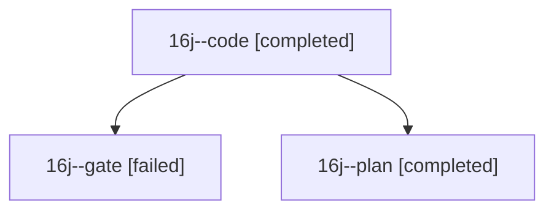

# Session: 16j

[Agent Hoods](../README.md) / [bbugyi200](../users/bbugyi200/README.md) / [athena](../users/bbugyi200/machines/athena/README.md) / [16j](../users/bbugyi200/machines/athena/hoods/16j/README.md) / 16j

Owner: `bbugyi200.athena` · Hood: `16j` · Members: 3

## Lineage

The diagram is an optional enhancement; the ordered table below contains the same lineage in accessible text.

| Role | Agent | State | Model / provider | Timing | Commits | Prompt | Chat |
|---|---|---|---|---|---:|---|---|
| code | 16j--code | completed | muse-spark-1.3-contributor / muse | 2026-10-30T20:41:23.104570+00:00 → 2026-10-30T21:05:55.963705+00:00 | [1](../agents/bbugyi200.athena.16j--code/README.md#commits) | [Prompt](../agents/bbugyi200.athena.16j--code/prompt.md) | [Chat](../agents/bbugyi200.athena.16j--code/chat.md) |
| gate | 16j--gate | failed | opus / claude | 2026-10-30T20:38:13.884066+00:00 → 2026-10-30T20:39:51.836348+00:00 | 0 | — | [Chat](../agents/bbugyi200.athena.16j--gate/chat.md) |
| plan | 16j--plan | completed | opus / claude | 2026-10-30T20:18:12.212930+00:00 → 2026-10-30T20:36:35.976383+00:00 | 0 | [Prompt](../agents/bbugyi200.athena.16j--plan/prompt.md) | [Chat](../agents/bbugyi200.athena.16j--plan/chat.md) |

## Commits

| Role | Repo | Commit | Subject | Committed |
|---|---|---|---|---|
| code | bob-cli | [`00ca6d0`](https://github.com/bobs-org/bob-cli/commit/00ca6d0c68578f0c521dcbfe1f0283bdd2cd39a4) | feat(promotion): offer new project tasks as successors | 2026-10-30 17:05:37 EDT |
