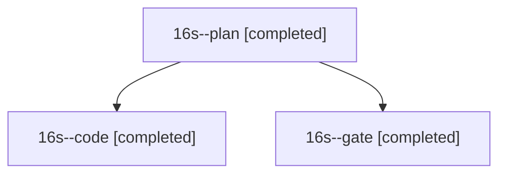

# Session: 16s

[Agent Hoods](../README.md) / [bbugyi200](../users/bbugyi200/README.md) / [athena](../users/bbugyi200/machines/athena/README.md) / [16s](../users/bbugyi200/machines/athena/hoods/16s/README.md) / 16s

Owner: `bbugyi200.athena` · Hood: `16s` · Members: 3

## Lineage

The diagram is an optional enhancement; the ordered table below contains the same lineage in accessible text.

| Role | Agent | State | Model / provider | Timing | Commits | Prompt | Chat |
|---|---|---|---|---|---:|---|---|
| plan | 16s--plan | completed | opus / claude | 2026-11-01T21:23:14.966106+00:00 → 2026-11-01T21:32:20.150492+00:00 | 0 | [Prompt](../agents/bbugyi200.athena.16s--plan/prompt.md) | [Chat](../agents/bbugyi200.athena.16s--plan/chat.md) |
| code | 16s--code | completed | muse-spark-1.3-contributor / muse | 2026-11-01T21:39:24.833436+00:00 → 2026-11-01T21:57:21.136494+00:00 | [1](../agents/bbugyi200.athena.16s--code/README.md#commits) | [Prompt](../agents/bbugyi200.athena.16s--code/prompt.md) | [Chat](../agents/bbugyi200.athena.16s--code/chat.md) |
| gate | 16s--gate | completed | opus / claude | 2026-11-01T21:33:30.189934+00:00 → 2026-11-01T21:36:52.642734+00:00 | 0 | — | [Chat](../agents/bbugyi200.athena.16s--gate/chat.md) |

## Commits

| Role | Repo | Commit | Subject | Committed |
|---|---|---|---|---|
| code | bob-cli | [`5824171`](https://github.com/bobs-org/bob-cli/commit/5824171e068c09cfbdfcff00339d4b8049fae9b7) | docs: route inbox Ctrl+Shift+Enter link before type | 2026-11-01 16:57:03 EST |
