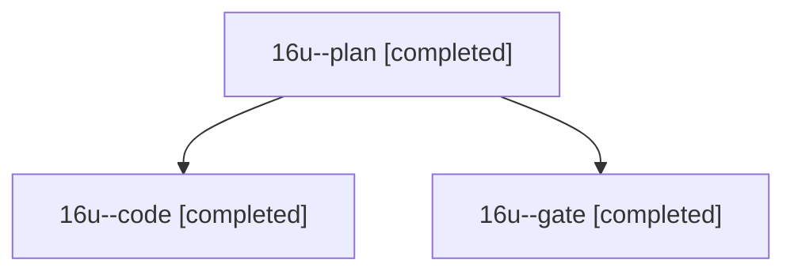

# Session: 16u

[Agent Hoods](../README.md) / [bbugyi200](../users/bbugyi200/README.md) / [athena](../users/bbugyi200/machines/athena/README.md) / [16u](../users/bbugyi200/machines/athena/hoods/16u/README.md) / 16u

Owner: `bbugyi200.athena` · Hood: `16u` · Members: 3

## Lineage

The diagram is an optional enhancement; the ordered table below contains the same lineage in accessible text.

| Role | Agent | State | Model / provider | Timing | Commits | Prompt | Chat |
|---|---|---|---|---|---:|---|---|
| plan | 16u--plan | completed | opus / claude | 2026-11-01T23:06:15.518136+00:00 → 2026-11-01T23:15:22.424535+00:00 | 0 | [Prompt](../agents/bbugyi200.athena.16u--plan/prompt.md) | [Chat](../agents/bbugyi200.athena.16u--plan/chat.md) |
| code | 16u--code | completed | muse-spark-1.3-contributor / muse | 2026-11-01T23:18:29.953194+00:00 → 2026-11-01T23:33:50.312673+00:00 | 0 | [Prompt](../agents/bbugyi200.athena.16u--code/prompt.md) | [Chat](../agents/bbugyi200.athena.16u--code/chat.md) |
| gate | 16u--gate | completed | opus / claude | 2026-11-01T23:15:50.958676+00:00 → 2026-11-01T23:17:08.057434+00:00 | 0 | — | [Chat](../agents/bbugyi200.athena.16u--gate/chat.md) |
