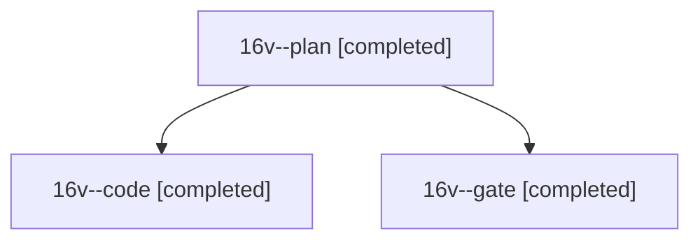

# Session: 16v

[Agent Hoods](../README.md) / [bbugyi200](../users/bbugyi200/README.md) / [athena](../users/bbugyi200/machines/athena/README.md) / [16v](../users/bbugyi200/machines/athena/hoods/16v/README.md) / 16v

Owner: `bbugyi200.athena` · Hood: `16v` · Members: 3

## Lineage

The diagram is an optional enhancement; the ordered table below contains the same lineage in accessible text.

| Role | Agent | State | Model / provider | Timing | Commits | Prompt | Chat |
|---|---|---|---|---|---:|---|---|
| plan | 16v--plan | completed | opus / claude | 2026-11-02T10:57:11.061547+00:00 → 2026-11-02T11:01:06.014793+00:00 | 0 | [Prompt](../agents/bbugyi200.athena.16v--plan/prompt.md) | [Chat](../agents/bbugyi200.athena.16v--plan/chat.md) |
| code | 16v--code | completed | sonnet / claude | 2026-11-02T11:03:35.688060+00:00 → 2026-11-02T11:16:20.373648+00:00 | 0 | [Prompt](../agents/bbugyi200.athena.16v--code/prompt.md) | [Chat](../agents/bbugyi200.athena.16v--code/chat.md) |
| gate | 16v--gate | completed | opus / claude | 2026-11-02T11:02:37.115098+00:00 → 2026-11-02T11:03:11.394621+00:00 | 0 | — | [Chat](../agents/bbugyi200.athena.16v--gate/chat.md) |
