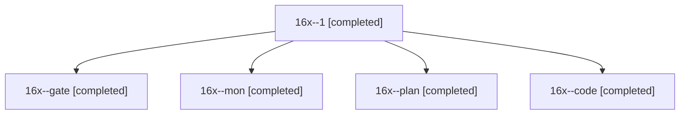

# Session: 16x

[Agent Hoods](../README.md) / [bbugyi200](../users/bbugyi200/README.md) / [athena](../users/bbugyi200/machines/athena/README.md) / [16x](../users/bbugyi200/machines/athena/hoods/16x/README.md) / 16x

Owner: `bbugyi200.athena` · Hood: `16x` · Members: 5

## Lineage

The diagram is an optional enhancement; the ordered table below contains the same lineage in accessible text.

| Role | Agent | State | Model / provider | Timing | Commits | Prompt | Chat |
|---|---|---|---|---|---:|---|---|
| 1 | 16x--1 | completed | gpt-6-luna / codex | 2026-11-02T12:15:05.212785+00:00 → 2026-11-02T12:16:13.910831+00:00 | 0 | [Prompt](../agents/bbugyi200.athena.16x--1/prompt.md) | [Chat](../agents/bbugyi200.athena.16x--1/chat.md) |
| gate | 16x--gate | completed | opus / claude | 2026-11-02T11:57:11.952261+00:00 → 2026-11-02T11:57:46.824106+00:00 | 0 | — | [Chat](../agents/bbugyi200.athena.16x--gate/chat.md) |
| mon | 16x--mon | completed | gpt-6-luna / codex | 2026-11-02T12:08:05.314782+00:00 → 2026-11-02T12:14:15.599448+00:00 | 0 | — | [Chat](../agents/bbugyi200.athena.16x--mon/chat.md) |
| plan | 16x--plan | completed | opus / claude | 2026-11-02T11:47:49.624043+00:00 → 2026-11-02T11:52:42.327991+00:00 | 0 | [Prompt](../agents/bbugyi200.athena.16x--plan/prompt.md) | [Chat](../agents/bbugyi200.athena.16x--plan/chat.md) |
| code | 16x--code | completed | gpt-6-luna / codex | 2026-11-02T11:58:22.728941+00:00 → 2026-11-02T12:08:11.762580+00:00 | 0 | [Prompt](../agents/bbugyi200.athena.16x--code/prompt.md) | [Chat](../agents/bbugyi200.athena.16x--code/chat.md) |
