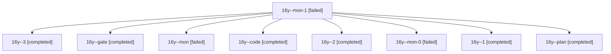

# Session: 16y

[Agent Hoods](../README.md) / [bbugyi200](../users/bbugyi200/README.md) / [athena](../users/bbugyi200/machines/athena/README.md) / [16y](../users/bbugyi200/machines/athena/hoods/16y/README.md) / 16y

Owner: `bbugyi200.athena` · Hood: `16y` · Members: 9

## Lineage

The diagram is an optional enhancement; the ordered table below contains the same lineage in accessible text.

| Role | Agent | State | Model / provider | Timing | Commits | Prompt | Chat |
|---|---|---|---|---|---:|---|---|
| mon-1 | 16y--mon-1 | failed | gpt-6-luna / codex | 2026-11-02T13:32:10.247551+00:00 → 2026-11-02T13:39:40.545717+00:00 | 0 | — | [Chat](../agents/bbugyi200.athena.16y--mon-1/chat.md) |
| 3 | 16y--3 | completed | gpt-6-luna / codex | 2026-11-02T13:39:36.685326+00:00 → 2026-11-02T13:47:35.941454+00:00 | [1](../agents/bbugyi200.athena.16y--3/README.md#commits) | [Prompt](../agents/bbugyi200.athena.16y--3/prompt.md) | [Chat](../agents/bbugyi200.athena.16y--3/chat.md) |
| gate | 16y--gate | completed | opus / claude | 2026-11-02T12:55:57.113968+00:00 → 2026-11-02T12:57:05.955712+00:00 | 0 | — | [Chat](../agents/bbugyi200.athena.16y--gate/chat.md) |
| mon | 16y--mon | failed | gpt-6-luna / codex | 2026-11-02T13:08:06.367386+00:00 → 2026-11-02T13:11:26.863633+00:00 | 0 | — | [Chat](../agents/bbugyi200.athena.16y--mon/chat.md) |
| code | 16y--code | completed | gpt-6-luna / codex | 2026-11-02T12:57:43.591979+00:00 → 2026-11-02T13:08:25.901932+00:00 | 0 | [Prompt](../agents/bbugyi200.athena.16y--code/prompt.md) | [Chat](../agents/bbugyi200.athena.16y--code/chat.md) |
| 2 | 16y--2 | completed | gpt-6-luna / codex | 2026-11-02T13:23:18.136771+00:00 → 2026-11-02T13:32:22.988701+00:00 | 0 | [Prompt](../agents/bbugyi200.athena.16y--2/prompt.md) | [Chat](../agents/bbugyi200.athena.16y--2/chat.md) |
| mon-0 | 16y--mon-0 | failed | gpt-6-luna / codex | 2026-11-02T13:14:08.236950+00:00 → 2026-11-02T13:22:23.015044+00:00 | 0 | — | [Chat](../agents/bbugyi200.athena.16y--mon-0/chat.md) |
| 1 | 16y--1 | completed | gpt-6-luna / codex | 2026-11-02T13:12:17.323686+00:00 → 2026-11-02T13:14:20.946353+00:00 | 0 | [Prompt](../agents/bbugyi200.athena.16y--1/prompt.md) | [Chat](../agents/bbugyi200.athena.16y--1/chat.md) |
| plan | 16y--plan | completed | opus / claude | 2026-11-02T12:43:56.151501+00:00 → 2026-11-02T12:50:33.496872+00:00 | 0 | [Prompt](../agents/bbugyi200.athena.16y--plan/prompt.md) | [Chat](../agents/bbugyi200.athena.16y--plan/chat.md) |

## Commits

| Role | Repo | Commit | Subject | Committed |
|---|---|---|---|---|
| 3 | bob-cli | [`fa1118c`](https://github.com/bobs-org/bob-cli/commit/fa1118c1efbe5dc35bdc7f288784c9e2b6cf6cac) | feat(gcal): sort event task links by meeting span | 2026-11-02 08:47:22 EST |
