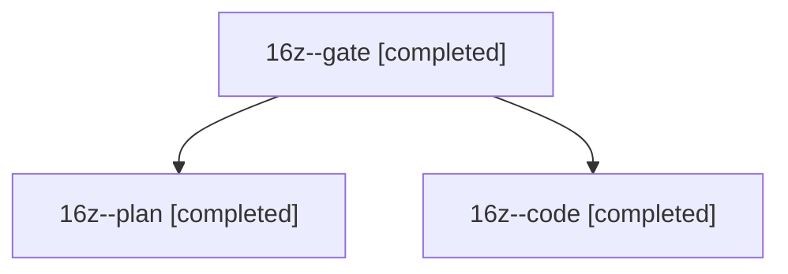

# Session: 16z

[Agent Hoods](../README.md) / [bbugyi200](../users/bbugyi200/README.md) / [athena](../users/bbugyi200/machines/athena/README.md) / [16z](../users/bbugyi200/machines/athena/hoods/16z/README.md) / 16z

Owner: `bbugyi200.athena` · Hood: `16z` · Members: 3

## Lineage

The diagram is an optional enhancement; the ordered table below contains the same lineage in accessible text.

| Role | Agent | State | Model / provider | Timing | Commits | Prompt | Chat |
|---|---|---|---|---|---:|---|---|
| gate | 16z--gate | completed | opus / claude | 2026-11-02T12:55:37.479898+00:00 → 2026-11-02T12:56:10.615543+00:00 | 0 | — | [Chat](../agents/bbugyi200.athena.16z--gate/chat.md) |
| plan | 16z--plan | completed | opus / claude | 2026-11-02T12:46:25.902296+00:00 → 2026-11-02T12:51:02.561239+00:00 | 0 | [Prompt](../agents/bbugyi200.athena.16z--plan/prompt.md) | [Chat](../agents/bbugyi200.athena.16z--plan/chat.md) |
| code | 16z--code | completed | muse-spark-1.3-contributor / muse | 2026-11-02T12:56:51.345895+00:00 → 2026-11-02T13:09:34.806778+00:00 | 0 | [Prompt](../agents/bbugyi200.athena.16z--code/prompt.md) | [Chat](../agents/bbugyi200.athena.16z--code/chat.md) |
