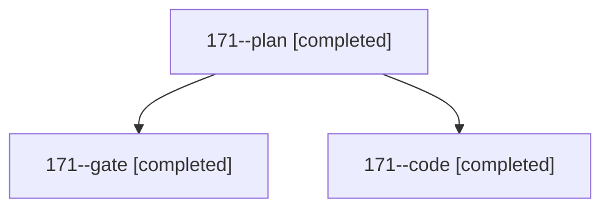

# Session: 171

[Agent Hoods](../README.md) / [bbugyi200](../users/bbugyi200/README.md) / [athena](../users/bbugyi200/machines/athena/README.md) / [171](../users/bbugyi200/machines/athena/hoods/171/README.md) / 171

Owner: `bbugyi200.athena` · Hood: `171` · Members: 3

## Lineage

The diagram is an optional enhancement; the ordered table below contains the same lineage in accessible text.

| Role | Agent | State | Model / provider | Timing | Commits | Prompt | Chat |
|---|---|---|---|---|---:|---|---|
| plan | 171--plan | completed | opus / claude | 2026-11-02T13:49:12.528828+00:00 → 2026-11-02T13:59:40.843368+00:00 | 0 | [Prompt](../agents/bbugyi200.athena.171--plan/prompt.md) | [Chat](../agents/bbugyi200.athena.171--plan/chat.md) |
| gate | 171--gate | completed | opus / claude | 2026-11-02T14:00:51.869901+00:00 → 2026-11-02T14:01:58.146264+00:00 | 0 | — | [Chat](../agents/bbugyi200.athena.171--gate/chat.md) |
| code | 171--code | completed | grok-4.6 / grok | 2026-11-02T14:02:35.363135+00:00 → 2026-11-02T14:49:03.391854+00:00 | [1](../agents/bbugyi200.athena.171--code/README.md#commits) | [Prompt](../agents/bbugyi200.athena.171--code/prompt.md) | [Chat](../agents/bbugyi200.athena.171--code/chat.md) |

## Commits

| Role | Repo | Commit | Subject | Committed |
|---|---|---|---|---|
| code | bob-cli | [`a67cc79`](https://github.com/bobs-org/bob-cli/commit/a67cc79a100fe4e3c011461dbc12067dd4d02070) | feat(capture): unnamed start joins the meeting in progress | 2026-11-02 09:48:37 EST |

## Neighbors

| Agent | Relation | State |
|---|---|---|
| [171.w0](../agents/bbugyi200.athena.171.w0/README.md) | descendant | active |
