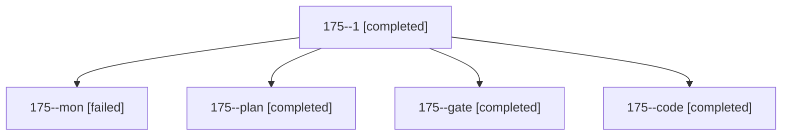

# Session: 175

[Agent Hoods](../README.md) / [bbugyi200](../users/bbugyi200/README.md) / [athena](../users/bbugyi200/machines/athena/README.md) / [175](../users/bbugyi200/machines/athena/hoods/175/README.md) / 175

Owner: `bbugyi200.athena` · Hood: `175` · Members: 5

## Lineage

The diagram is an optional enhancement; the ordered table below contains the same lineage in accessible text.

| Role | Agent | State | Model / provider | Timing | Commits | Prompt | Chat |
|---|---|---|---|---|---:|---|---|
| 1 | 175--1 | completed | muse-spark-1.3-contributor / muse | 2026-11-02T18:30:50.691554+00:00 → 2026-11-02T18:43:45.889522+00:00 | [1](../agents/bbugyi200.athena.175--1/README.md#commits) | [Prompt](../agents/bbugyi200.athena.175--1/prompt.md) | [Chat](../agents/bbugyi200.athena.175--1/chat.md) |
| mon | 175--mon | failed | muse-spark-1.3-contributor / muse | 2026-11-02T18:26:12.404505+00:00 → 2026-11-02T18:29:58.018929+00:00 | 0 | — | [Chat](../agents/bbugyi200.athena.175--mon/chat.md) |
| plan | 175--plan | completed | opus / claude | 2026-11-02T17:27:41.043927+00:00 → 2026-11-02T17:48:44.099349+00:00 | 0 | [Prompt](../agents/bbugyi200.athena.175--plan/prompt.md) | [Chat](../agents/bbugyi200.athena.175--plan/chat.md) |
| gate | 175--gate | completed | opus / claude | 2026-11-02T17:49:54.100343+00:00 → 2026-11-02T17:50:30.263932+00:00 | 0 | — | [Chat](../agents/bbugyi200.athena.175--gate/chat.md) |
| code | 175--code | completed | muse-spark-1.3-contributor / muse | 2026-11-02T17:51:04.475767+00:00 → 2026-11-02T18:26:25.358138+00:00 | 0 | [Prompt](../agents/bbugyi200.athena.175--code/prompt.md) | [Chat](../agents/bbugyi200.athena.175--code/chat.md) |

## Commits

| Role | Repo | Commit | Subject | Committed |
|---|---|---|---|---|
| 1 | bob-cli | [`5fffb82`](https://github.com/bobs-org/bob-cli/commit/5fffb82ab7e3dd3ed87c57d72fcc27f207f9c019) | fix(gcal): write title-free badge links, read location from Maps URL | 2026-11-02 13:43:33 EST |
