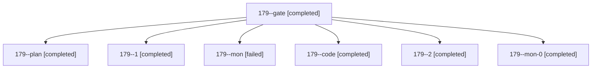

# Session: 179

[Agent Hoods](../README.md) / [bbugyi200](../users/bbugyi200/README.md) / [athena](../users/bbugyi200/machines/athena/README.md) / [179](../users/bbugyi200/machines/athena/hoods/179/README.md) / 179

Owner: `bbugyi200.athena` · Hood: `179` · Members: 7

## Lineage

The diagram is an optional enhancement; the ordered table below contains the same lineage in accessible text.

| Role | Agent | State | Model / provider | Timing | Commits | Prompt | Chat |
|---|---|---|---|---|---:|---|---|
| gate | 179--gate | completed | opus / claude | 2026-11-03T14:35:08.864351+00:00 → 2026-11-03T14:35:56.751787+00:00 | 0 | — | [Chat](../agents/bbugyi200.athena.179--gate/chat.md) |
| plan | 179--plan | completed | opus / claude | 2026-11-03T14:23:25.497207+00:00 → 2026-11-03T14:29:28.370275+00:00 | 0 | [Prompt](../agents/bbugyi200.athena.179--plan/prompt.md) | [Chat](../agents/bbugyi200.athena.179--plan/chat.md) |
| 1 | 179--1 | completed | grok-4.6 / grok | 2026-11-03T14:43:39.522167+00:00 → 2026-11-03T14:49:13.352206+00:00 | 0 | [Prompt](../agents/bbugyi200.athena.179--1/prompt.md) | [Chat](../agents/bbugyi200.athena.179--1/chat.md) |
| mon | 179--mon | failed | grok-4.6 / grok | 2026-11-03T14:39:30.895506+00:00 → 2026-11-03T14:42:42.838748+00:00 | 0 | — | [Chat](../agents/bbugyi200.athena.179--mon/chat.md) |
| code | 179--code | completed | grok-4.6 / grok | 2026-11-03T14:36:34.814365+00:00 → 2026-11-03T14:40:11.336064+00:00 | 0 | [Prompt](../agents/bbugyi200.athena.179--code/prompt.md) | [Chat](../agents/bbugyi200.athena.179--code/chat.md) |
| 2 | 179--2 | completed | grok-4.6 / grok | 2026-11-03T15:25:02.573414+00:00 → 2026-11-03T15:26:29.054319+00:00 | 0 | [Prompt](../agents/bbugyi200.athena.179--2/prompt.md) | [Chat](../agents/bbugyi200.athena.179--2/chat.md) |
| mon-0 | 179--mon-0 | completed | grok-4.6 / grok | 2026-11-03T14:48:02.320677+00:00 → 2026-11-03T15:24:00.699835+00:00 | 0 | — | [Chat](../agents/bbugyi200.athena.179--mon-0/chat.md) |
