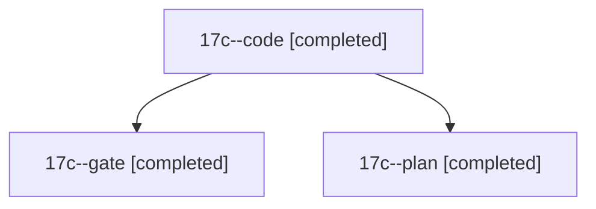

# Session: 17c

[Agent Hoods](../README.md) / [bbugyi200](../users/bbugyi200/README.md) / [athena](../users/bbugyi200/machines/athena/README.md) / [17c](../users/bbugyi200/machines/athena/hoods/17c/README.md) / 17c

Owner: `bbugyi200.athena` · Hood: `17c` · Members: 3

## Lineage

The diagram is an optional enhancement; the ordered table below contains the same lineage in accessible text.

| Role | Agent | State | Model / provider | Timing | Commits | Prompt | Chat |
|---|---|---|---|---|---:|---|---|
| code | 17c--code | completed | grok-4.6 / grok | 2026-11-03T15:47:13.875683+00:00 → 2026-11-03T16:40:23.044160+00:00 | 0 | [Prompt](../agents/bbugyi200.athena.17c--code/prompt.md) | [Chat](../agents/bbugyi200.athena.17c--code/chat.md) |
| gate | 17c--gate | completed | opus / claude | 2026-11-03T15:45:48.279241+00:00 → 2026-11-03T15:46:36.995133+00:00 | 0 | — | [Chat](../agents/bbugyi200.athena.17c--gate/chat.md) |
| plan | 17c--plan | completed | opus / claude | 2026-11-03T15:35:08.628675+00:00 → 2026-11-03T15:45:24.838237+00:00 | 0 | [Prompt](../agents/bbugyi200.athena.17c--plan/prompt.md) | [Chat](../agents/bbugyi200.athena.17c--plan/chat.md) |
