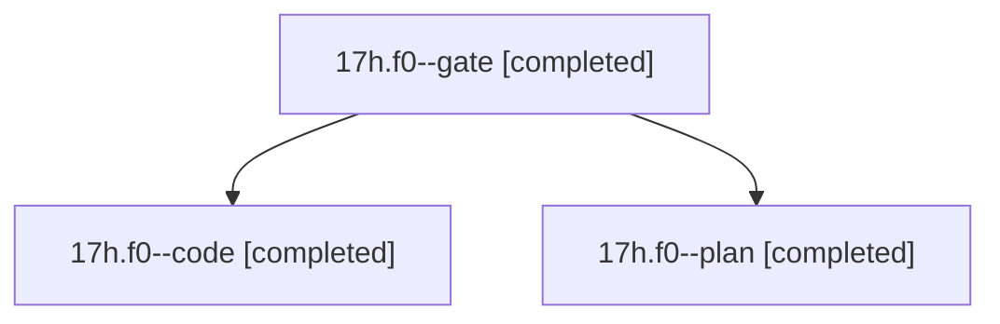

# Session: 17h.f0

[Agent Hoods](../README.md) / [bbugyi200](../users/bbugyi200/README.md) / [athena](../users/bbugyi200/machines/athena/README.md) / [17h](../users/bbugyi200/machines/athena/hoods/17h/README.md) / 17h.f0

Owner: `bbugyi200.athena` · Hood: `17h` · Members: 3

## Lineage

The diagram is an optional enhancement; the ordered table below contains the same lineage in accessible text.

| Role | Agent | State | Model / provider | Timing | Commits | Prompt | Chat |
|---|---|---|---|---|---:|---|---|
| gate | 17h.f0--gate | completed | opus / claude | 2026-11-03T18:31:38.401455+00:00 → 2026-11-03T18:32:28.252636+00:00 | 0 | — | [Chat](../agents/bbugyi200.athena.17h.f0--gate/chat.md) |
| code | 17h.f0--code | completed | muse-spark-1.3-contributor / muse | 2026-11-03T18:33:05.891707+00:00 → 2026-11-03T18:41:44.806188+00:00 | 0 | [Prompt](../agents/bbugyi200.athena.17h.f0--code/prompt.md) | [Chat](../agents/bbugyi200.athena.17h.f0--code/chat.md) |
| plan | 17h.f0--plan | completed | opus / claude | 2026-11-03T18:24:54.834806+00:00 → 2026-11-03T18:30:54.615360+00:00 | 0 | [Prompt](../agents/bbugyi200.athena.17h.f0--plan/prompt.md) | [Chat](../agents/bbugyi200.athena.17h.f0--plan/chat.md) |

## Neighbors

| Agent | Relation | State |
|---|---|---|
| [17h](bbugyi200.athena.17h.md) (session · 3) | ancestor | completed 3 |
