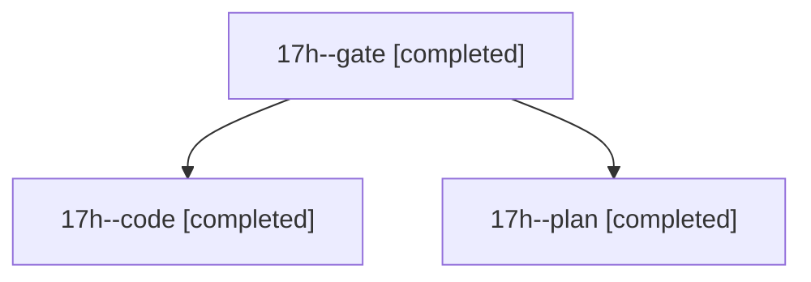

# Session: 17h

[Agent Hoods](../README.md) / [bbugyi200](../users/bbugyi200/README.md) / [athena](../users/bbugyi200/machines/athena/README.md) / [17h](../users/bbugyi200/machines/athena/hoods/17h/README.md) / 17h

Owner: `bbugyi200.athena` · Hood: `17h` · Members: 3

## Lineage

The diagram is an optional enhancement; the ordered table below contains the same lineage in accessible text.

| Role | Agent | State | Model / provider | Timing | Commits | Prompt | Chat |
|---|---|---|---|---|---:|---|---|
| gate | 17h--gate | completed | opus / claude | 2026-11-03T17:50:49.559560+00:00 → 2026-11-03T17:51:29.374116+00:00 | 0 | — | [Chat](../agents/bbugyi200.athena.17h--gate/chat.md) |
| code | 17h--code | completed | gpt-6-luna / codex | 2026-11-03T17:58:48.920240+00:00 → 2026-11-03T18:11:14.857727+00:00 | 0 | [Prompt](../agents/bbugyi200.athena.17h--code/prompt.md) | [Chat](../agents/bbugyi200.athena.17h--code/chat.md) |
| plan | 17h--plan | completed | opus / claude | 2026-11-03T17:28:22.498511+00:00 → 2026-11-03T17:48:58.496680+00:00 | 0 | [Prompt](../agents/bbugyi200.athena.17h--plan/prompt.md) | [Chat](../agents/bbugyi200.athena.17h--plan/chat.md) |

## Neighbors

| Agent | Relation | State |
|---|---|---|
| [17h.f0](bbugyi200.athena.17h.f0.md) (session · 3) | descendant | completed 3 |
