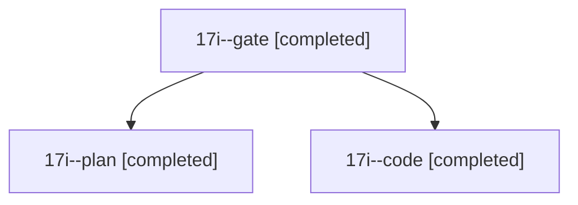

# Session: 17i

[Agent Hoods](../README.md) / [bbugyi200](../users/bbugyi200/README.md) / [athena](../users/bbugyi200/machines/athena/README.md) / [17i](../users/bbugyi200/machines/athena/hoods/17i/README.md) / 17i

Owner: `bbugyi200.athena` · Hood: `17i` · Members: 3

## Lineage

The diagram is an optional enhancement; the ordered table below contains the same lineage in accessible text.

| Role | Agent | State | Model / provider | Timing | Commits | Prompt | Chat |
|---|---|---|---|---|---:|---|---|
| gate | 17i--gate | completed | opus / claude | 2026-11-03T17:48:18.550352+00:00 → 2026-11-03T17:49:21.596830+00:00 | 0 | — | [Chat](../agents/bbugyi200.athena.17i--gate/chat.md) |
| plan | 17i--plan | completed | opus / claude | 2026-11-03T17:33:47.130745+00:00 → 2026-11-03T17:45:21.762242+00:00 | 0 | [Prompt](../agents/bbugyi200.athena.17i--plan/prompt.md) | [Chat](../agents/bbugyi200.athena.17i--plan/chat.md) |
| code | 17i--code | completed | muse-spark-1.3-contributor / muse | 2026-11-03T17:49:59.375998+00:00 → 2026-11-03T18:30:19.074080+00:00 | [1](../agents/bbugyi200.athena.17i--code/README.md#commits) | [Prompt](../agents/bbugyi200.athena.17i--code/prompt.md) | [Chat](../agents/bbugyi200.athena.17i--code/chat.md) |

## Commits

| Role | Repo | Commit | Subject | Committed |
|---|---|---|---|---|
| code | bob-cli | [`3b1cf13`](https://github.com/bobs-org/bob-cli/commit/3b1cf138f1012376efc7c2053c5f588821937738) | feat(capture): file clipboard notes directly under existing tasks | 2026-11-03 13:29:59 EST |
