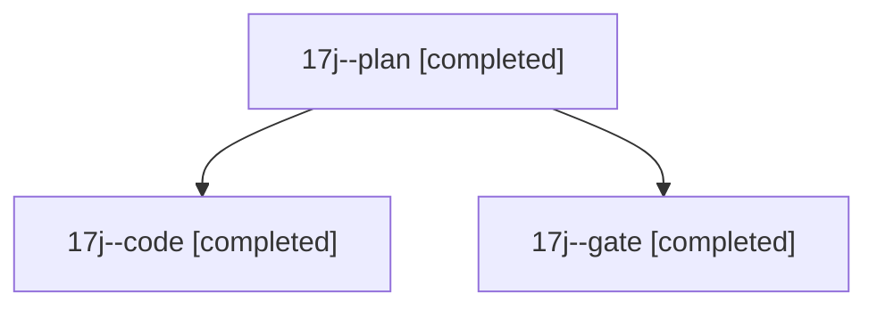

# Session: 17j

[Agent Hoods](../README.md) / [bbugyi200](../users/bbugyi200/README.md) / [athena](../users/bbugyi200/machines/athena/README.md) / [17j](../users/bbugyi200/machines/athena/hoods/17j/README.md) / 17j

Owner: `bbugyi200.athena` · Hood: `17j` · Members: 3

## Lineage

The diagram is an optional enhancement; the ordered table below contains the same lineage in accessible text.

| Role | Agent | State | Model / provider | Timing | Commits | Prompt | Chat |
|---|---|---|---|---|---:|---|---|
| plan | 17j--plan | completed | opus / claude | 2026-11-03T17:51:25.955025+00:00 → 2026-11-03T17:58:34.301055+00:00 | 0 | [Prompt](../agents/bbugyi200.athena.17j--plan/prompt.md) | [Chat](../agents/bbugyi200.athena.17j--plan/chat.md) |
| code | 17j--code | completed | muse-spark-1.3-contributor / muse | 2026-11-03T18:01:45.279374+00:00 → 2026-11-03T18:16:42.888596+00:00 | 0 | [Prompt](../agents/bbugyi200.athena.17j--code/prompt.md) | [Chat](../agents/bbugyi200.athena.17j--code/chat.md) |
| gate | 17j--gate | completed | opus / claude | 2026-11-03T17:58:30.248460+00:00 → 2026-11-03T18:01:05.388687+00:00 | 0 | — | [Chat](../agents/bbugyi200.athena.17j--gate/chat.md) |
