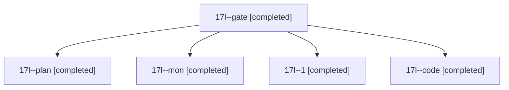

# Session: 17l

[Agent Hoods](../README.md) / [bbugyi200](../users/bbugyi200/README.md) / [athena](../users/bbugyi200/machines/athena/README.md) / [17l](../users/bbugyi200/machines/athena/hoods/17l/README.md) / 17l

Owner: `bbugyi200.athena` · Hood: `17l` · Members: 5

## Lineage

The diagram is an optional enhancement; the ordered table below contains the same lineage in accessible text.

| Role | Agent | State | Model / provider | Timing | Commits | Prompt | Chat |
|---|---|---|---|---|---:|---|---|
| gate | 17l--gate | completed | opus / claude | 2026-11-03T19:24:16.976237+00:00 → 2026-11-03T19:24:37.777564+00:00 | 0 | — | [Chat](../agents/bbugyi200.athena.17l--gate/chat.md) |
| plan | 17l--plan | completed | opus / claude | 2026-11-03T19:18:26.662416+00:00 → 2026-11-03T19:27:56.387318+00:00 | 0 | [Prompt](../agents/bbugyi200.athena.17l--plan/prompt.md) | [Chat](../agents/bbugyi200.athena.17l--plan/chat.md) |
| mon | 17l--mon | completed | gpt-6-luna / codex | 2026-11-03T19:27:27.577184+00:00 → 2026-11-03T19:36:27.167368+00:00 | 0 | — | [Chat](../agents/bbugyi200.athena.17l--mon/chat.md) |
| 1 | 17l--1 | completed | gpt-6-luna / codex | 2026-11-03T19:37:30.961985+00:00 → 2026-11-03T19:38:17.731822+00:00 | [1](../agents/bbugyi200.athena.17l--1/README.md#commits) | [Prompt](../agents/bbugyi200.athena.17l--1/prompt.md) | [Chat](../agents/bbugyi200.athena.17l--1/chat.md) |
| code | 17l--code | completed | gpt-6-luna / codex | 2026-11-03T19:25:07.258284+00:00 → 2026-11-03T19:27:56.387318+00:00 | 0 | — | [Chat](../agents/bbugyi200.athena.17l--code/chat.md) |

## Commits

| Role | Repo | Commit | Subject | Committed |
|---|---|---|---|---|
| 1 | bob-cli | [`9a60639`](https://github.com/bobs-org/bob-cli/commit/9a606395c05f95230de0f90d9274ba045ef0ee03) | fix(capture): initialize note pull result | 2026-11-03 14:38:09 EST |
