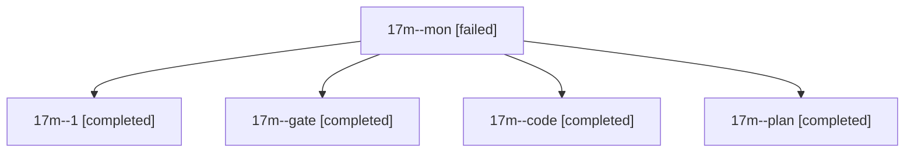

# Session: 17m

[Agent Hoods](../README.md) / [bbugyi200](../users/bbugyi200/README.md) / [athena](../users/bbugyi200/machines/athena/README.md) / [17m](../users/bbugyi200/machines/athena/hoods/17m/README.md) / 17m

Owner: `bbugyi200.athena` · Hood: `17m` · Members: 5

## Lineage



The diagram is an optional enhancement; the ordered table below contains the same lineage in accessible text.

| Role | Agent | State | Model / provider | Timing | Commits | Prompt | Chat |
|---|---|---|---|---|---:|---|---|
| <a id="member-mon"></a>mon | 17m--mon | failed | gpt-6-luna / codex | 2026-11-03T20:05:43.034139+00:00 → 2026-11-03T20:22:54.666138+00:00 | 0 | — | [Chat](../agents/bbugyi200.athena.17m--mon/chat.md) |
| <a id="member-1"></a>1 | 17m--1 | completed | gpt-6-luna / codex | 2026-11-03T20:23:50.216984+00:00 → 2026-11-03T20:36:32.737999+00:00 | [1](../agents/bbugyi200.athena.17m--1/README.md#commits) | [Prompt](../agents/bbugyi200.athena.17m--1/prompt.md) | [Chat](../agents/bbugyi200.athena.17m--1/chat.md) |
| <a id="member-gate"></a>gate | 17m--gate | completed | opus / claude | 2026-11-03T19:40:31.494397+00:00 → 2026-11-03T19:41:04.835043+00:00 | 0 | — | [Chat](../agents/bbugyi200.athena.17m--gate/chat.md) |
| <a id="member-code"></a>code | 17m--code | completed | gpt-6-luna / codex | 2026-11-03T19:41:41.933325+00:00 → 2026-11-03T20:06:39.781051+00:00 | 0 | [Prompt](../agents/bbugyi200.athena.17m--code/prompt.md) | [Chat](../agents/bbugyi200.athena.17m--code/chat.md) |
| <a id="member-plan"></a>plan | 17m--plan | completed | opus / claude | 2026-11-03T19:31:47.590048+00:00 → 2026-11-03T19:39:25.647924+00:00 | 0 | [Prompt](../agents/bbugyi200.athena.17m--plan/prompt.md) | [Chat](../agents/bbugyi200.athena.17m--plan/chat.md) |

## Commits

| Role | Repo | Commit | Subject | Committed |
|---|---|---|---|---|
| 1 | bob-cli | [`6e7e789`](https://github.com/bobs-org/bob-cli/commit/6e7e7890b1dc3089f1191b092181c042d1730247) | docs(plan): document TODAY badge contract parity | 2026-11-03 15:36:09 EST |

## Variables

| Role | Variable | Value |
|---|---|---|
| 1 | `artifacts` | \[{kind: markdown, label: Bob Mac Capture macOS CI failure evidence: run 41709503302, path: /home/bryan/.sase/artifacts/agents/gh\_bobs-org\_\_bob-cli/20261103152154/macos-ci-run-41709503302-6aa8fd078242… |

#### artifacts

**Role:** `1`

```yaml
- kind: markdown
  label: Bob Mac Capture macOS CI failure evidence: run 41709503302
  path: /home/bryan/.sase/artifacts/agents/gh_bobs-org__bob-cli/20261103152154/macos-ci-run-41709503302-6aa8fd078242.md
  ref: file:explicit:b8de9d2e1ad7e25ea841ac15
  source_path: /home/bryan/.local/state/sase/workspaces/bobs-org/bob-cli/bob-cli_26/.macos-ci-run-41709503302.md
```

Values are truncated for display; see each member's agent meta.json for the full values.
