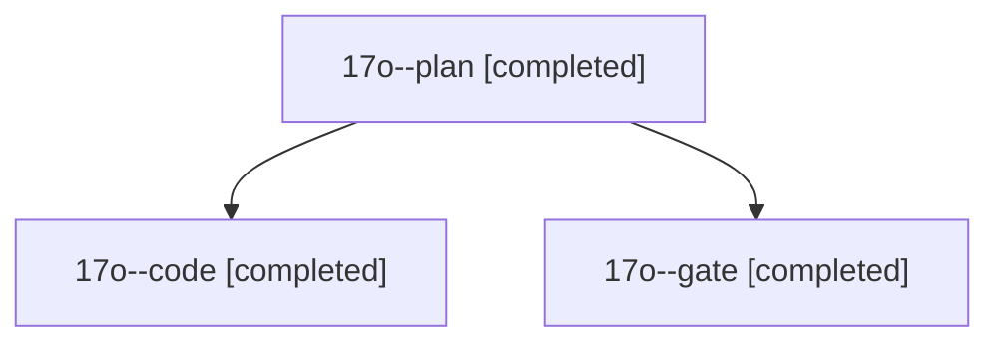

# Session: 17o

[Agent Hoods](../README.md) / [bbugyi200](../users/bbugyi200/README.md) / [athena](../users/bbugyi200/machines/athena/README.md) / [17o](../users/bbugyi200/machines/athena/hoods/17o/README.md) / 17o

Owner: `bbugyi200.athena` · Hood: `17o` · Members: 3

## Lineage

The diagram is an optional enhancement; the ordered table below contains the same lineage in accessible text.

| Role | Agent | State | Model / provider | Timing | Commits | Prompt | Chat |
|---|---|---|---|---|---:|---|---|
| plan | 17o--plan | completed | opus / claude | 2026-11-03T19:45:13.862021+00:00 → 2026-11-03T19:54:42.489005+00:00 | 0 | [Prompt](../agents/bbugyi200.athena.17o--plan/prompt.md) | [Chat](../agents/bbugyi200.athena.17o--plan/chat.md) |
| code | 17o--code | completed | muse-spark-1.3-contributor / muse | 2026-11-03T19:57:44.536239+00:00 → 2026-11-03T20:35:34.307454+00:00 | [1](../agents/bbugyi200.athena.17o--code/README.md#commits) | [Prompt](../agents/bbugyi200.athena.17o--code/prompt.md) | [Chat](../agents/bbugyi200.athena.17o--code/chat.md) |
| gate | 17o--gate | completed | opus / claude | 2026-11-03T19:55:30.115711+00:00 → 2026-11-03T19:57:08.003339+00:00 | 0 | — | [Chat](../agents/bbugyi200.athena.17o--gate/chat.md) |

## Commits

| Role | Repo | Commit | Subject | Committed |
|---|---|---|---|---|
| code | bob-cli | [`7024b86`](https://github.com/bobs-org/bob-cli/commit/7024b86dbbf05418ee850e678f5d7e1172fb48df) | feat(pomodoro): show last closed Pomodoro with --last | 2026-11-03 15:35:06 EST |
