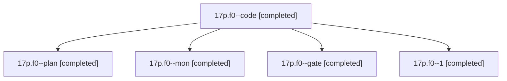

# Session: 17p.f0

[Agent Hoods](../README.md) / [bbugyi200](../users/bbugyi200/README.md) / [athena](../users/bbugyi200/machines/athena/README.md) / [17p](../users/bbugyi200/machines/athena/hoods/17p/README.md) / 17p.f0

Owner: `bbugyi200.athena` · Hood: `17p` · Members: 5

## Lineage

The diagram is an optional enhancement; the ordered table below contains the same lineage in accessible text.

| Role | Agent | State | Model / provider | Timing | Commits | Prompt | Chat |
|---|---|---|---|---|---:|---|---|
| code | 17p.f0--code | completed | gpt-6-luna / codex | 2026-11-03T20:56:21.375063+00:00 → 2026-11-03T20:59:38.753193+00:00 | 0 | — | [Chat](../agents/bbugyi200.athena.17p.f0--code/chat.md) |
| plan | 17p.f0--plan | completed | opus / claude | 2026-11-03T20:46:52.885660+00:00 → 2026-11-03T20:59:38.753193+00:00 | 0 | [Prompt](../agents/bbugyi200.athena.17p.f0--plan/prompt.md) | [Chat](../agents/bbugyi200.athena.17p.f0--plan/chat.md) |
| mon | 17p.f0--mon | completed | gpt-6-luna / codex | 2026-11-03T20:59:09.686732+00:00 → 2026-11-03T21:07:23.296948+00:00 | 0 | — | [Chat](../agents/bbugyi200.athena.17p.f0--mon/chat.md) |
| gate | 17p.f0--gate | completed | opus / claude | 2026-11-03T20:55:23.313450+00:00 → 2026-11-03T20:55:45.654563+00:00 | 0 | — | [Chat](../agents/bbugyi200.athena.17p.f0--gate/chat.md) |
| 1 | 17p.f0--1 | completed | gpt-6-luna / codex | 2026-11-03T21:08:22.107501+00:00 → 2026-11-03T21:09:15.653506+00:00 | [1](../agents/bbugyi200.athena.17p.f0--1/README.md#commits) | [Prompt](../agents/bbugyi200.athena.17p.f0--1/prompt.md) | [Chat](../agents/bbugyi200.athena.17p.f0--1/chat.md) |

## Commits

| Role | Repo | Commit | Subject | Committed |
|---|---|---|---|---|
| 1 | bob-cli | [`de01143`](https://github.com/bobs-org/bob-cli/commit/de01143e7389d0c351f7b9189d300d3eb9af919e) | fix(capture): initialize note pull in capture result | 2026-11-03 16:09:07 EST |

## Neighbors

| Agent | Relation | State |
|---|---|---|
| [17p](bbugyi200.athena.17p.md) (session · 3) | ancestor | completed 3 |
