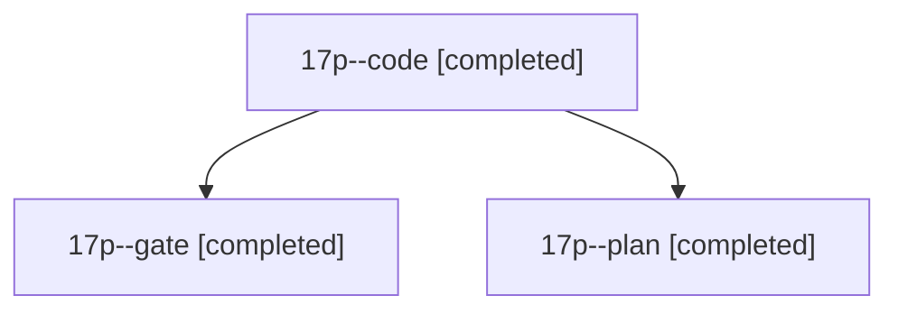

# Session: 17p

[Agent Hoods](../README.md) / [bbugyi200](../users/bbugyi200/README.md) / [athena](../users/bbugyi200/machines/athena/README.md) / [17p](../users/bbugyi200/machines/athena/hoods/17p/README.md) / 17p

Owner: `bbugyi200.athena` · Hood: `17p` · Members: 3

## Lineage

The diagram is an optional enhancement; the ordered table below contains the same lineage in accessible text.

| Role | Agent | State | Model / provider | Timing | Commits | Prompt | Chat |
|---|---|---|---|---|---:|---|---|
| code | 17p--code | completed | gpt-6-luna / codex | 2026-11-03T20:08:08.124974+00:00 → 2026-11-03T20:19:17.621034+00:00 | [1](../agents/bbugyi200.athena.17p--code/README.md#commits) | — | [Chat](../agents/bbugyi200.athena.17p--code/chat.md) |
| gate | 17p--gate | completed | opus / claude | 2026-11-03T20:06:53.129119+00:00 → 2026-11-03T20:07:30.542024+00:00 | 0 | — | [Chat](../agents/bbugyi200.athena.17p--gate/chat.md) |
| plan | 17p--plan | completed | opus / claude | 2026-11-03T19:59:22.582647+00:00 → 2026-11-03T20:19:17.621034+00:00 | 0 | [Prompt](../agents/bbugyi200.athena.17p--plan/prompt.md) | [Chat](../agents/bbugyi200.athena.17p--plan/chat.md) |

## Commits

| Role | Repo | Commit | Subject | Committed |
|---|---|---|---|---|
| code | bob-cli | [`e74f4f0`](https://github.com/bobs-org/bob-cli/commit/e74f4f08fc92f27842a7339967fd6b993078ff09) | fix(capture): remove duplicate note pull initializer | 2026-11-03 15:18:39 EST |

## Neighbors

| Agent | Relation | State |
|---|---|---|
| [17p.f0](bbugyi200.athena.17p.f0.md) (session · 5) | descendant | completed 5 |
