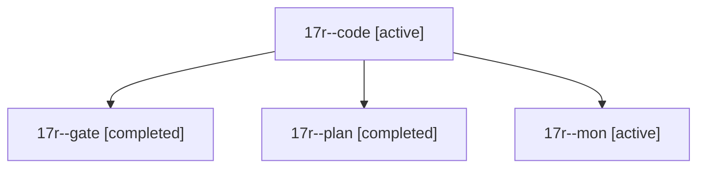

# Session: 17r

[Agent Hoods](../README.md) / [bbugyi200](../users/bbugyi200/README.md) / [athena](../users/bbugyi200/machines/athena/README.md) / [17r](../users/bbugyi200/machines/athena/hoods/17r/README.md) / 17r

Owner: `bbugyi200.athena` · Hood: `17r` · Members: 4

## Lineage

The diagram is an optional enhancement; the ordered table below contains the same lineage in accessible text.

| Role | Agent | State | Model / provider | Timing | Commits | Prompt | Chat |
|---|---|---|---|---|---:|---|---|
| code | 17r--code | active | muse-spark-1.3-contributor / muse | 2026-11-03T22:10:05.619086+00:00 | 0 | [Prompt](../agents/bbugyi200.athena.17r--code/prompt.md) | — |
| gate | 17r--gate | completed | opus / claude | 2026-11-03T22:08:33.639049+00:00 → 2026-11-03T22:09:28.980969+00:00 | 0 | — | [Chat](../agents/bbugyi200.athena.17r--gate/chat.md) |
| plan | 17r--plan | completed | opus / claude | 2026-11-03T21:52:01.560551+00:00 → 2026-11-03T22:04:57.340523+00:00 | 0 | [Prompt](../agents/bbugyi200.athena.17r--plan/prompt.md) | [Chat](../agents/bbugyi200.athena.17r--plan/chat.md) |
| mon | 17r--mon | active | muse-spark-1.3-contributor / muse | 2026-11-03T22:28:40.248020+00:00 | 0 | — | — |
