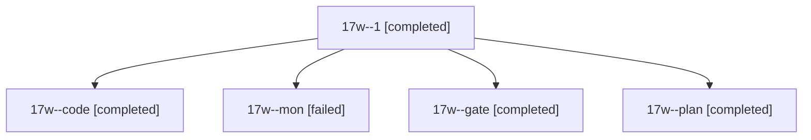

# Session: 17w

[Agent Hoods](../README.md) / [bbugyi200](../users/bbugyi200/README.md) / [athena](../users/bbugyi200/machines/athena/README.md) / [17w](../users/bbugyi200/machines/athena/hoods/17w/README.md) / 17w

Owner: `bbugyi200.athena` · Hood: `17w` · Members: 5

## Lineage

The diagram is an optional enhancement; the ordered table below contains the same lineage in accessible text.

| Role | Agent | State | Model / provider | Timing | Commits | Prompt | Chat |
|---|---|---|---|---|---:|---|---|
| 1 | 17w--1 | completed | gpt-6-luna / codex | 2026-11-04T12:32:39.332499+00:00 → 2026-11-04T12:37:05.158580+00:00 | 0 | [Prompt](../agents/bbugyi200.athena.17w--1/prompt.md) | [Chat](../agents/bbugyi200.athena.17w--1/chat.md) |
| code | 17w--code | completed | gpt-6-luna / codex | 2026-11-04T12:22:25.200503+00:00 → 2026-11-04T12:29:13.715305+00:00 | 0 | [Prompt](../agents/bbugyi200.athena.17w--code/prompt.md) | [Chat](../agents/bbugyi200.athena.17w--code/chat.md) |
| mon | 17w--mon | failed | gpt-6-luna / codex | 2026-11-04T12:28:35.030328+00:00 → 2026-11-04T12:31:38.672029+00:00 | 0 | — | — |
| gate | 17w--gate | completed | opus / claude | 2026-11-04T12:21:09.151586+00:00 → 2026-11-04T12:21:46.466453+00:00 | 0 | — | [Chat](../agents/bbugyi200.athena.17w--gate/chat.md) |
| plan | 17w--plan | completed | opus / claude | 2026-11-04T12:09:04.144743+00:00 → 2026-11-04T12:16:47.390773+00:00 | 0 | [Prompt](../agents/bbugyi200.athena.17w--plan/prompt.md) | [Chat](../agents/bbugyi200.athena.17w--plan/chat.md) |
