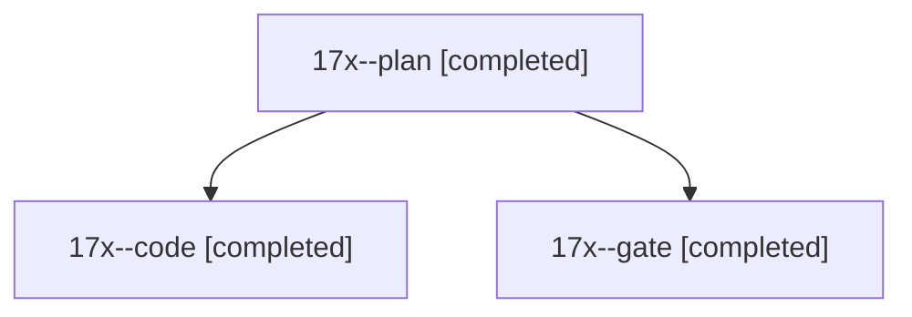

# Session: 17x

[Agent Hoods](../README.md) / [bbugyi200](../users/bbugyi200/README.md) / [athena](../users/bbugyi200/machines/athena/README.md) / [17x](../users/bbugyi200/machines/athena/hoods/17x/README.md) / 17x

Owner: `bbugyi200.athena` · Hood: `17x` · Members: 3

## Lineage

The diagram is an optional enhancement; the ordered table below contains the same lineage in accessible text.

| Role | Agent | State | Model / provider | Timing | Commits | Prompt | Chat |
|---|---|---|---|---|---:|---|---|
| plan | 17x--plan | completed | opus / claude | 2026-11-04T14:16:15.298757+00:00 → 2026-11-04T14:20:44.778116+00:00 | 0 | [Prompt](../agents/bbugyi200.athena.17x--plan/prompt.md) | [Chat](../agents/bbugyi200.athena.17x--plan/chat.md) |
| code | 17x--code | completed | muse-spark-1.3-contributor / muse | 2026-11-04T14:40:57.871305+00:00 → 2026-11-04T14:46:34.605875+00:00 | [1](../agents/bbugyi200.athena.17x--code/README.md#commits) | [Prompt](../agents/bbugyi200.athena.17x--code/prompt.md) | [Chat](../agents/bbugyi200.athena.17x--code/chat.md) |
| gate | 17x--gate | completed | opus / claude | 2026-11-04T14:39:32.948820+00:00 → 2026-11-04T14:40:22.828410+00:00 | 0 | — | [Chat](../agents/bbugyi200.athena.17x--gate/chat.md) |

## Commits

| Role | Repo | Commit | Subject | Committed |
|---|---|---|---|---|
| code | bob-cli | [`27feff8`](https://github.com/bobs-org/bob-cli/commit/27feff8712056a73c2be47c4ee13869c620f6a67) | fix(capture): drop unused AsRawFd import in shell guard | 2026-11-04 09:46:26 EST |
