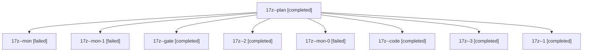

# Session: 17z

[Agent Hoods](../README.md) / [bbugyi200](../users/bbugyi200/README.md) / [athena](../users/bbugyi200/machines/athena/README.md) / [17z](../users/bbugyi200/machines/athena/hoods/17z/README.md) / 17z

Owner: `bbugyi200.athena` · Hood: `17z` · Members: 9

## Lineage

The diagram is an optional enhancement; the ordered table below contains the same lineage in accessible text.

| Role | Agent | State | Model / provider | Timing | Commits | Prompt | Chat |
|---|---|---|---|---|---:|---|---|
| plan | 17z--plan | completed | opus / claude | 2026-11-04T16:10:21.958898+00:00 → 2026-11-04T16:17:56.978081+00:00 | 0 | [Prompt](../agents/bbugyi200.athena.17z--plan/prompt.md) | [Chat](../agents/bbugyi200.athena.17z--plan/chat.md) |
| mon | 17z--mon | failed | gpt-6-luna / codex | 2026-11-04T16:39:53.299711+00:00 → 2026-11-04T16:44:04.579029+00:00 | 0 | — | [Chat](../agents/bbugyi200.athena.17z--mon/chat.md) |
| mon-1 | 17z--mon-1 | failed | gpt-6-luna / codex | 2026-11-04T16:53:42.938415+00:00 → 2026-11-04T16:59:35.210197+00:00 | 0 | — | [Chat](../agents/bbugyi200.athena.17z--mon-1/chat.md) |
| gate | 17z--gate | completed | opus / claude | 2026-11-04T16:24:08.490484+00:00 → 2026-11-04T16:24:45.015390+00:00 | 0 | — | [Chat](../agents/bbugyi200.athena.17z--gate/chat.md) |
| 2 | 17z--2 | completed | gpt-6-luna / codex | 2026-11-04T16:51:45.228299+00:00 → 2026-11-04T16:54:25.395609+00:00 | 0 | [Prompt](../agents/bbugyi200.athena.17z--2/prompt.md) | [Chat](../agents/bbugyi200.athena.17z--2/chat.md) |
| mon-0 | 17z--mon-0 | failed | gpt-6-luna / codex | 2026-11-04T16:46:50.890266+00:00 → 2026-11-04T16:50:54.532158+00:00 | 0 | — | [Chat](../agents/bbugyi200.athena.17z--mon-0/chat.md) |
| code | 17z--code | completed | gpt-6-luna / codex | 2026-11-04T16:25:26.025266+00:00 → 2026-11-04T16:40:42.736888+00:00 | 0 | [Prompt](../agents/bbugyi200.athena.17z--code/prompt.md) | [Chat](../agents/bbugyi200.athena.17z--code/chat.md) |
| 3 | 17z--3 | completed | gpt-6-luna / codex | 2026-11-04T17:00:30.794378+00:00 → 2026-11-04T17:03:51.935434+00:00 | [1](../agents/bbugyi200.athena.17z--3/README.md#commits) | [Prompt](../agents/bbugyi200.athena.17z--3/prompt.md) | [Chat](../agents/bbugyi200.athena.17z--3/chat.md) |
| 1 | 17z--1 | completed | gpt-6-luna / codex | 2026-11-04T16:44:52.197625+00:00 → 2026-11-04T16:47:30.564655+00:00 | 0 | [Prompt](../agents/bbugyi200.athena.17z--1/prompt.md) | [Chat](../agents/bbugyi200.athena.17z--1/chat.md) |

## Commits

| Role | Repo | Commit | Subject | Committed |
|---|---|---|---|---|
| 3 | bob-cli | [`bbb5856`](https://github.com/bobs-org/bob-cli/commit/bbb5856fe07cfd337e232d6a24dabf8b08f8ead2) | feat(gcal): complete past synced event tasks | 2026-11-04 12:03:38 EST |
