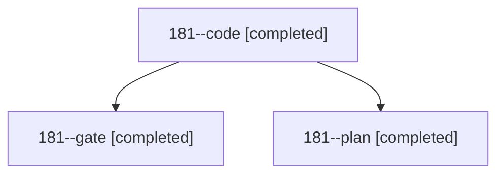

# Session: 181

[Agent Hoods](../README.md) / [bbugyi200](../users/bbugyi200/README.md) / [athena](../users/bbugyi200/machines/athena/README.md) / [181](../users/bbugyi200/machines/athena/hoods/181/README.md) / 181

Owner: `bbugyi200.athena` · Hood: `181` · Members: 3

## Lineage

The diagram is an optional enhancement; the ordered table below contains the same lineage in accessible text.

| Role | Agent | State | Model / provider | Timing | Commits | Prompt | Chat |
|---|---|---|---|---|---:|---|---|
| code | 181--code | completed | muse-spark-1.3-contributor / muse | 2026-11-04T17:31:28.644418+00:00 → 2026-11-04T18:19:07.947009+00:00 | [1](../agents/bbugyi200.athena.181--code/README.md#commits) | [Prompt](../agents/bbugyi200.athena.181--code/prompt.md) | [Chat](../agents/bbugyi200.athena.181--code/chat.md) |
| gate | 181--gate | completed | opus / claude | 2026-11-04T17:29:55.926625+00:00 → 2026-11-04T17:30:53.696587+00:00 | 0 | — | [Chat](../agents/bbugyi200.athena.181--gate/chat.md) |
| plan | 181--plan | completed | opus / claude | 2026-11-04T17:17:10.973320+00:00 → 2026-11-04T17:24:53.931958+00:00 | 0 | [Prompt](../agents/bbugyi200.athena.181--plan/prompt.md) | [Chat](../agents/bbugyi200.athena.181--plan/chat.md) |

## Commits

| Role | Repo | Commit | Subject | Committed |
|---|---|---|---|---|
| code | bob-cli | [`5c9b6e4`](https://github.com/bobs-org/bob-cli/commit/5c9b6e42258d2ad99cfb1e2c60ec1a8d8c8e21ff) | feat(highlights)!: stamp minute-precision captured time in every ref create marker | 2026-11-04 13:18:54 EST |
