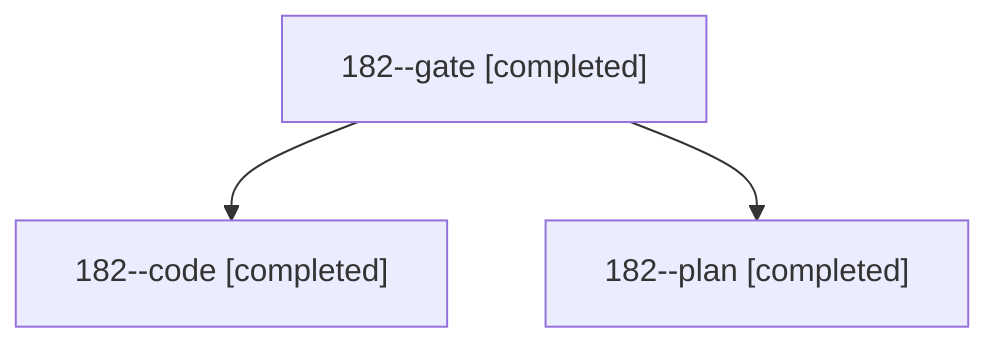

# Session: 182

[Agent Hoods](../README.md) / [bbugyi200](../users/bbugyi200/README.md) / [athena](../users/bbugyi200/machines/athena/README.md) / [182](../users/bbugyi200/machines/athena/hoods/182/README.md) / 182

Owner: `bbugyi200.athena` · Hood: `182` · Members: 3

## Lineage

The diagram is an optional enhancement; the ordered table below contains the same lineage in accessible text.

| Role | Agent | State | Model / provider | Timing | Commits | Prompt | Chat |
|---|---|---|---|---|---:|---|---|
| gate | 182--gate | completed | opus / claude | 2026-11-04T18:19:19.811210+00:00 → 2026-11-04T18:20:08.806328+00:00 | 0 | — | [Chat](../agents/bbugyi200.athena.182--gate/chat.md) |
| code | 182--code | completed | muse-spark-1.3-contributor / muse | 2026-11-04T18:20:44.425038+00:00 → 2026-11-04T18:40:51.730267+00:00 | 0 | [Prompt](../agents/bbugyi200.athena.182--code/prompt.md) | [Chat](../agents/bbugyi200.athena.182--code/chat.md) |
| plan | 182--plan | completed | opus / claude | 2026-11-04T18:09:12.148378+00:00 → 2026-11-04T18:18:52.374033+00:00 | 0 | [Prompt](../agents/bbugyi200.athena.182--plan/prompt.md) | [Chat](../agents/bbugyi200.athena.182--plan/chat.md) |
